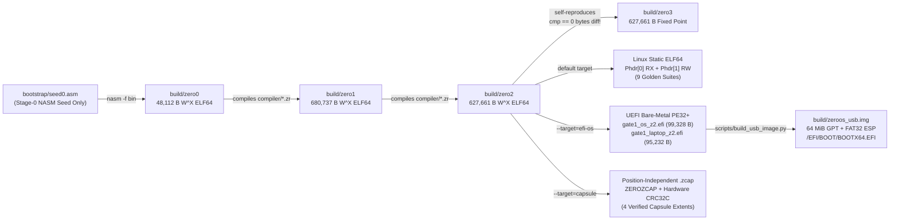

# `Zero` (`.zr`) — Self-Hosted Silicon Compiler & Bare-Metal `ZeroOS`

> **`Zero` (`.zr`)** is a systems programming language and direct native `x86-64` compiler written from scratch — with **zero C, zero LLVM, zero libc, zero `malloc`, and zero external linker** — co-designed with **`ZeroOS`**, a single-image, strictly `W^X`, reactor-driven Ring-0 operating system targeting **11th Gen Intel Tiger Lake (`Core i7-1165G7` Willow Cove + `Iris Xe` Gen12LP + PCIe NVMe)**.

> [!IMPORTANT]
> **Core Engineering Honesty Rule:**
> Neither the compiler nor the documentation ever claims a construct exists before it lowers to verified machine instructions. Any unlowered syntax, attribute, memory space, or loop lens is a **hard compile-time error** tested by negative probes.
> - **Implemented & Verified Today (`build/zero2` == `build/zero3` at `627,661 B`, `97 PASS / 0 FAIL`):** Tracks 1–3 + **Stage 1 Next-Generation `Zero` Language Spine** (`ptr*`, `ref&`, `ptr* @oneshot`, `;` flag-handoff, `mask<...>`, `when` / `with when` / `when while` / `when for`, `@ring(s..n)`, `@bits`), documented below, in `ZERO_NEXT_GEN_SPEC.md` §2, `ZERO_OS_ARCHITECTURE.md`, and `CHANGES_AND_VERIFICATION_REPORT.md`.
> - **Frozen Specification for Next Stage (Stage 2 `ZeroFS` `ZLEDGER1` + Hardware Domains):** Documented in full engineer-to-engineer detail in **`ZERO_NEXT_GEN_SPEC.md` §3**.

---

## Documentation Suite Map (Start Here)

| Document | Scope & Audience |
| :--- | :--- |
| **`README.md`** *(this file)* | Repository map, self-hosted `compiler/*.zr` internals, complete **Implemented Construct & Opcode Matrix**, and build/test/USB instructions. |
| **`ZERO_NEXT_GEN_SPEC.md`** | **Stage 1 Implemented Spine (§2) & Stage 2 Frozen `ZeroFS` Spec (§3):** `ptr*` / `ref&`, `ptr* @oneshot` register capability & `xor` wipe, `;` flag-handoff law, `mask<...>` zero-`cmp` `RFLAGS` fusion (`bextr`/`bt`/`test`/volatile spin), `when` / `with when` / `when while` / `when for`, `@ring` / `@bits`, the 135-line canonical `.zr` reference program, non-POSIX hardware domains, and **`ZeroFS` (`ZLEDGER1`)** CoW storage. |
| **`ZERO_OS_ARCHITECTURE.md`** | Deep Ring-0 kernel reference: UEFI `PE32+` boot prelude, 4-level `W^X` `CR3` paging, `<1 MiB` `x2APIC` `INIT-SIPI` SMP wake, Reactor ABI (`r12..r15` + `gs:0`), Zero-XSAVE Ring-0 `AVX-512` proof, `MOVDIR64B`/`MWAIT` fabric, `IRQ1` keyboard, and NVMe `@dma_queue` + `.zcap` capsules. |
| **`CHANGES_AND_VERIFICATION_REPORT.md`** | Exact artifact byte sizes, `zero2 == zero3` fixed-point proof (`627,661 B`), `objdump` disassembly gates, 70 negative compile-rejection probes, multi-core telemetry (`C=4, 2, 1`), and GPT+FAT32 USB verification. |

---

## 1. Self-Hosting Bootstrap & Target Emission Pipeline



---

## 2. Repository Architecture

```text
/home/arch-cetin/projects/zero/
├── README.md                          # Master language & compiler architecture manual
├── ZERO_NEXT_GEN_SPEC.md              # Frozen Stage-1 Language Spine & Stage-2 ZeroFS (ZLEDGER1) spec
├── ZERO_OS_ARCHITECTURE.md            # Bare-metal Ring-0 kernel, paging, Reactor ABI & NVMe architecture
├── CHANGES_AND_VERIFICATION_REPORT.md # Empirical fixed-point, opcode, QEMU/KVM & USB verification ledger
├── PEER_MASTER_PLAN.md                # Historical Phase-0 audit record (superseded by live docs above)
├── MESSAGE_TO_PEER_AGENT.md           # Historical initial design handoff archive
├── Makefile                           # `make test` (7 stages), `make usb-img`, `make qemu`, `make clean`
├── bootstrap/                         # Stage-0 x86-64 NASM seed (`zero0`) — ONLY assembly in the repo
│   ├── seed0.asm                      # W^X ELF64 entry + CLI (`--lex`, `--target=efi-os`, `--target=capsule`)
│   └── *.inc                          # Stage-0 bootstrap parser/emitter used solely to build `zero1`
├── compiler/                          # 100% Pure `.zr` Self-Hosted Compiler (11 modules, ~471 KB source)
│   ├── zero1.zr                       # Prescan, statement/lvalue/`@oneshot`/`RFLAGS` driver & CLI
│   ├── defs.zr                        # `TOK_*`/`KW_*`/`TY_*`/`FLAG_*` constants, static `@slab` arenas, host syscalls
│   ├── lexer.zr                       # Tokenizer, line-end `;` rejection, recursive canonical `use "rel/path.zr"`
│   ├── types_spaces.zr                # `::` fixpoint solver, `ptr*`/`ref&`/`@oneshot`, `struct @cell64`, `T[N]`, spaces
│   ├── parser_expr.zr                 # Pratt expressions, `mask<...>`, `ptr*` cast/index/arith, `ref&`, ZMM ALU
│   ├── intrinsics_ptr.zr              # `mask<...>` BMI1/BT/spin lowering, `@oneshot` verifiers, `ref&` lvalue binder
│   ├── loops_match.zr                 # `when` / `with when` / `when while` / `when for`, `@ring(s..n)`, `@bits`, `<tile>`, `<simd>`
│   ├── emit_x64.zr                    # Native x86-64 encoder (64B RSP, `bextr`/`bt`, `@oneshot` `mov`+`xor` wipes)
│   ├── evex_zmm.zr                    # 4-byte `EVEX` (`0x62`) encoder (`zmm0..7`, `{k1}{z}`/`{k1}`, `vmovntdq`, reductions)
│   ├── efi_pe32.zr                    # Standalone PE32+ UEFI writer (boot prelude, `<1M` AP bridge, 256 ISR stubs)
│   └── containers.zr                  # 2-segment W^X ELF64 & CRC32C-signed `ZEROZCAP` (`.zcap`) binary writers
├── examples/
│   ├── first.zr                       # Minimal standalone Linux W^X `ELF64` program
│   ├── capsule_compute.zr             # NVMe Extent 0 (`CAP=777` / 4-core `2337` Reactor-ABI compute capsule)
│   ├── capsules/
│   │   ├── cap_avx512_wave.zr         # NVMe Extent 1: Ring-0 AVX-512 `u64x8` wave kernel inside `tile { }`
│   │   └── cap_matrix_crc.zr          # NVMe Extent 2: Hardware CRC32C + BMI2 `pext`/`pdep` + `rol` matrix kernel
│   ├── gate1_os.zr                    # ZeroOS root entry: W^X, SMP, NVMe, IRQ1, HUD & Obsidian Command Deck
│   └── os/
│       ├── hw_types.zr                # `BootHandoff`, `ReactorLocal`, `@PtePtr`, `@port`s, `@ring`s, `@dma_queue`s
│       ├── debug_io.zr                # Port-`0xE9` telemetry (`0` instructions emitted when `qemu_debug :: 0`)
│       ├── paging_wx.zr               # 4-level W^X page-table builder, `verify_no_wx_pages`, GDT/TSS/IDT, capsule sealing
│       ├── smp_madt.zr                # ACPI `MADT` parser + `x2APIC` `INIT-SIPI` multi-core AP bring-up
│       ├── reactor_fabric.zr          # `MOVDIR64B`/`MWAIT` worker loop, `CMD_EXEC_CAPSULE`, AVX-512 bench, `@isr`
│       ├── nvme_capsule.zr            # PCIe `MCFG`/`ECAM`, NVMe `@dma_queue` driver, multi-extent DMA + CRC32C + RX seal
│       ├── ioapic_kbd.zr              # `MADT` I/O APIC + ISO, 8259 mask, `@isr` IRQ1 -> `0x21`, tickless `MWAIT` key wait
│       └── hud_render.zr              # AVX-512 `vmovntdq` GOP scanout, 5x7 font, status LEDs/pips, Command Deck UI
├── scripts/
│   └── build_usb_image.py             # Generates 64 MiB protective-MBR + GPT + FAT32 USB stick (`BOOTX64.EFI`)
└── tests/
    ├── run_tests.sh                   # 7-stage automated verifier (`97 PASS, 0 FAIL` in ~14s under KVM)
    ├── lib/                           # Diamond-import multi-file `use "lib/..."` modules
    └── *.zr / *.expected              # `first`, `step3_compute`, `step4_systems`, `phase0..5` golden suites
```

---

## 3. Self-Hosted Compiler Architecture (`compiler/*.zr`)

Engineers modifying `compiler/*.zr` should understand six core invariants of the self-hosted compiler:

1. **Zero-Heap Static `@slab` Memory Model:**
   - Every `Zero` binary (`zero1`, `zero2`, and compiled `ELF64` guests) consists of exactly **two `PT_LOAD` segments**:
     - `Phdr[0]` at `0x0040_0000` (`PF_R | PF_X`): ELF headers + `.text` machine code + inline RIP-relative literals.
     - `Phdr[1]` at `0x1000_0000` (`PF_R | PF_W`, `p_filesz = 0`): Zero-initialized `.bss` holding disjoint bounds-checked `@slab` tables (`tok_*`, `sym_*`, `cst_*`, `ut_*`, `sp_*`, `fn_*`, `loc_*`, `out_buf`).
   - `compiler/*.zr` invokes **only 7 Linux syscalls**: `openat` (`257`), `read` (`0`), `write` (`1`), `lseek` (`8`), `fchmod` (`91`), `close` (`3`), and `exit` (`60`). It never calls `brk`/`mmap` or spawns external assemblers/linkers.
2. **Canonical Recursive `use "..."` Module Expansion (`compiler/lexer.zr`):**
   - Resolves `use "rel/path.zr"` relative to the importing file's directory, normalizes `.` and `..` segments, and deduplicates diamond imports via hardware `crc32` path interning before token stream assembly.
3. **Two-Pass Fixed-Point Constant & Layout Solver (`compiler/types_spaces.zr`):**
   - Order-independent `NAME :: expr` constants, `<field: uN | ...>` bitpacks, structs, `@cell64`, custom `@ptr` lenses, and `@sizeof(T)` / `@alignof(T)` queries iterate to a fixed point. Unresolved cycles or duplicate names fail compilation deterministically.
4. **Unified 32-Bit Type Tag Encoding (`compiler/defs.zr`):**
   - Bits `[11:0]` (`TY_BASE_MASK = 0x0FFF`): primitive scalars (`TY_I64=1 .. TY_U8=8`), 512-bit vectors (`TY_U32X16=9`, `TY_U64X8=10`), `TY_BP_BASE + idx` (`0x100+`), `TY_STRUCT_BASE + idx` (`0x300+`), `TY_PTR_BASE + idx` (`0x500+`).
   - Upper modifier flags: `TY_FLAG_VIEW1` (`0x1000` 8B single-object pointer), `TY_FLAG_SPAN` (`0x2000` 16B `{ptr, len}` slice), `TY_FLAG_MMIO` (`0x4000` volatile uncached aperture), `TY_FLAG_STREAM` (`0x8000` non-temporal `movnti`/`vmovntdq`), `TY_FLAG_ATOMIC` (`0x10000` `lock` operations), `TY_FLAG_PTR` (`0x20000` raw `ptr* T`), `TY_FLAG_ONESHOT` (`0x40000` ephemeral GPR-only `ptr* @oneshot T`), and `TY_FLAG_REF` (`0x80000` non-null `ref& T` lvalue alias).
5. **Inductive 64-Byte Stack Alignment (`RSP & 63 == 0` in `compiler/emit_x64.zr`):**
   - Every function prologue reserves `frame_bytes = 64 * k - 16` (`48`, `112`, `176`, … bytes after `8B call rip + 8B push rbp`), keeping `RSP` **64-byte cacheline aligned** at every call site and `<tile>` boundary without dynamic stack realignment.
   - Local scalars within `[-128, +127]` of `rbp` encode with compact 1-byte `disp8`; `EVEX` 512-bit spills use compressed `disp8 * 64` addressing.
6. **Direct `EVEX` (`0x62`) `AVX-512` & `{k1}` Opmask Encoder (`compiler/evex_zmm.zr`):**
   - Encodes 4-byte `0x62` prefixes directly for `zmm0..zmm7`, zero-masking `{k1}{z}` loads, merging `{k1}` stores, `bzhi` + `kmovw k1, eax` branchless loop tails, `vmovntdq` streaming stores, and horizontal `vextracti64x4` reductions.

---

## 4. Verified Implementation Matrix (`build/zero2` Today vs Next-Gen Spec)

| Category / Construct | Status | Exact Machine Lowering & Enforced Invariants |
| :--- | :---: | :--- |
| **2-Segment `W^X` `ELF64`, `PE32+`, & `.zcap` Containers** | **Implemented** | Zero `RWX` segments/sections across host `ELF64`, UEFI `PE32+` (`--target=efi-os`), and CRC32C-signed position-independent `.zcap` (`--target=capsule`). |
| **100% Self-Hosted Fixed Point (`zero2 == zero3`)** | **Implemented** | `627,661 B` byte-identical fixed point (`cmp -s build/zero2 build/zero3`). With `build/zero0` deleted, `zero2` rebuilds itself, all tests, all capsules, and `ZeroOS` byte-for-byte. |
| **Scalars, Unsigned Rules, Bit-Slices `[hi:lo]`, Rotates & `\|>`** | **Implemented** | `i8..i64`, `u8..u64`, `bit`, `bool`, `mask64`; unsigned `shr`/`div`/`setb..seta`; div-by-zero `fail 1`; inline bitfield extract `x[hi:lo]` & RMW `lval[hi:lo] = v`; `<<<`/`>>>` (`rol`/`ror`); `x \|> f(a)` pipelines; `fn f() T => expr`; comptime dead-branch `if` elimination (`qemu_debug :: 0`). |
| **BitPacks `<a: u32 \| ...>`, Structs `Name :: { ... }`, `@Type`** | **Implemented** | Exact 8/16/32/64-bit packed integers; natural/`<packed>`/`<align: 64B>`/`@cell64` structs; `Struct{...}` literals; `rep movsb` copy; non-null `@Type` pointer parameters (`fail 3` on null). |
| **Spaces (`@slab`, `@arena`, `@capsule`, `@ring`, `@dma_queue`, `@port`)** | **Implemented** | `@slab`/`@arena`/`@capsule` emit unsigned bounds check `idx < cap` (`fail 2`); `@ring`/`@dma_queue` wrap `(idx & (cap - 1))` (`4 KiB` aligned for DMA); `@port` emits direct `in`/`out`. `--target=capsule` rejects mutable `.bss` spaces. |
| **Slices (`str`, `bytes`, `[]T`, `@view`, `@span`) & Custom `@ptr`** | **Implemented** | 16B `{base, len}` slices (`RAX:RDX` returns, inline RX `.text` string literals on all targets, checked `s[lo..hi]`); `Name :: @ptr<T \| mask \| wrap \| stride \| bswap>` zero-call pointer lenses. |
| **`@stream` (`movnti`), `@atomic` (`lock`), & Code Reflection** | **Implemented** | `@stream` $\rightarrow$ `movnti`; `@atomic` $\rightarrow$ `xchg`, `lock xadd`, `lock cmpxchg`; `@fn_addr`, `@code_bytes(fn)` (`{base, exact_len}` of compiled machine code), `@call`, `@emit`. |
| **Silicon Intrinsics (`BMI1/2`, `CRC32C`, Fences, `CPUID`, Ring-0)** | **Implemented** | Inline `@popcnt`, `@lzcnt`, `@tzcnt`, `@bswap16/32/64`, `@pdep`, `@pext`, `@crc32c`, `@prefetch`, `@clflush`, `@lfence`/`@sfence`/`@mfence`, `@cpuid_ecx`, `@rdmsr`/`@wrmsr`, `@rdtsc`, `@lgdt`/`@lidt`/`@ltr`, `@read_cr3`/`@write_cr3`, `@invlpg`, `@xsetbv`, `@wrpkru`. |
| **Reactor ABI (`r12..r15`, `gs:0`), `publish`, `wait`, `<tile>`, `@isr`** | **Implemented** | `rdi, rsi, rdx, r10, r8, r9`; pinned `r12..r15`; `[gs:0]` `fail`/`recover` unwind; `publish` $\rightarrow$ `movdir64b`; `@movdiri`; race-free `wait` $\rightarrow$ `monitor` + recheck + `mwait`; `<tile>` unwind + `vzeroupper`; GPR-only `@isr`/`@isr_ok`. |
| **512-Bit Ring-0 `AVX-512` (`u32x16`, `u64x8`, `<simd: 8\|16>`)** | **Implemented** | Full ZMM ALU, `@vec_splat`, `@vec_iota`, `{k1}{z}` masked `@vec_load`, `{k1}` masked `@vec_store`, `@vec_stream` (`vmovntdq`), 64b-safe `@vec_sum`, `<simd>` loops with `{k1}` tails, enforced inside `<tile>` on Ring-0 targets. |
| **Bare-Metal `ZeroOS`: `W^X`, `x2APIC` SMP, NVMe `@capsule`s, `IRQ1` Deck & USB** | **Implemented** | 4-core Q35+KVM+OVMF+NVMe boot, 3 CRC32C-verified W^X-sealed `.zcap` extents dispatched across workers (`CAP1=2337`, `CAP2=1207754`, `CAP3=35277270`), tickless `IRQ1`/`MWAIT` Obsidian Command Deck, and `build/zeroos_usb.img` GPT+FAT32 boot stick. |
| **Stage 1: Next-Gen Spine (`ptr*`, `ref&`, `ptr* @oneshot`, `;` flag-handoff, `mask<...>`, `when` / `with when` / `when while` / `when for`, `@ring(s..n)`, `@bits`)** | **Implemented** | Raw 8B `ptr* T`, zero-sigil caller `ref& T`, zero-spill GPR-only `ptr* @oneshot T` (`[r10, r9, rsi, rdi]` + immediate `xor` wipes), line-end `;` parse error, zero-`cmp` `mask<...>` (`bextr`, `bt`, `test`, 3-part `pause`+`dec rcx` spin), `when`/`with when`/`when while`/`when for`, `@ring(s..n)`, and `tzcnt`+`blsr` `@bits` (`tests/phase5_nextgen_spine.zr` + `cap_spine_probe.zcap`). |
| **Stage 2: Non-POSIX Hardware Domains & `ZeroFS` (`ZLEDGER1`) CoW Ledger** | **Frozen Spec (`ZERO_NEXT_GEN_SPEC.md`)** | Specified in `ZERO_NEXT_GEN_SPEC.md` §3 — 2 MiB generational buckets, Eytzinger `@crc32c` B-tree, `000..111` adaptive pieces, seekable `128b XMM` `AES-NI`/`SHA-NI` lock, and `ZLEDGER1` magic write guard. |
| **`<tile: Size>` Cache-Blocking, `@cold` Splitting, `Iris Xe` `CCS0` GPU Walker** | **Future Target (Rejected Today)** | Explicitly rejected at compile time (or unscheduled until Gate 4) per the Honesty Rule. |

---

## 5. Building, Verifying, Emulating & Flashing to USB

### Core Commands

```bash
# 1. Full clean bootstrap + 7-stage verification suite (~14 seconds with KVM; 97 PASS / 0 FAIL)
make clean && make test

# 2. Build physical laptop 64 MiB GPT + FAT32 bootable USB image (qemu_debug :: 0, zero 0xE9 I/O)
make usb-img

# 3. Launch interactive 4-core Q35 + KVM + OVMF + NVMe graphical session (SDL window)
make qemu
```

### What `make test` (`tests/run_tests.sh`) Verifies Automatically

1. **Stage 1 (Self-Hosting & `W^X`):** Builds `zero0 -> zero1 -> zero2 -> zero3`, verifies `cmp -s zero2 zero3` (`627,661 B`, `0` diff), checks `readelf -lW` for zero `RWE` segments, and tests `--lex`.
2. **Stage 2 (9 Golden Suites & Disassembly Audit):** Compiles `first`, `step3_compute`, `step4_systems`, `phase0_scalar`, `phase1_zero_lang`, `phase2_zero_power`, `phase3_reactor_fabric`, `phase4_avx512_simd`, and `phase5_nextgen_spine` via `build/zero2`, diffs stdout against `.expected`, and verifies exact silicon/EVEX + Stage-1 Next-Gen Spine instructions (`bextr`, `bt`, `blsr`, `tzcnt`, `@oneshot` `mov`+`xor` wipes, zero-`cmp` `RFLAGS` fusion) via `objdump -d`.
3. **Stage 3 (70 Negative Compile-Rejection Probes):** Verifies `build/zero2` rejects 70 invalid programs across `ELF64`, `--target=efi-os`, and `--target=capsule` (54 baseline probes + 16 Stage-1 probes covering line-end `;`, `struct @cell64` size != 64B, `@oneshot` double-use/2-hop/call-hazard/leak/asymmetric-branch/struct-field, `ref&` rvalue/`@oneshot`, dead `ZF`, multi-bit `CF`, `@ring` on `@slab`, and scalar spin `mask<...>`).
4. **Stage 4 (Unhandled Fault Exit):** Confirms uncaught `fail` exits with status `1`.
5. **Stage 5 (Bare-Metal Containers):** Builds 4 `.zcap` capsules (`capsule_z2`, `cap_avx512_wave`, `cap_matrix_crc`, and Ring-0 Next-Gen Spine `cap_spine_probe.zcap`) + debug `gate1_os_z2.efi` + `qemu_debug :: 0` `gate1_laptop_z2.efi` (proving `0` port-`0xE9` instructions in laptop binary vs `7` in debug control).
6. **Stage 6 (Live Multi-Core `ZeroOS` Under QEMU/KVM + OVMF + NVMe):** Boots 4-core SMP, injects PS/2 keys `1 2 3 b a q`, verifies exact capsule sums (`2337`, `1207754`, `35277270`), framebuffer pixel colors, IRQ1 counter, `-smp 1` fallback, NVMe-less fallback, and `-vga none` clean return.
7. **Stage 7 (Bootable GPT + FAT32 USB Stick):** Audits protective MBR + primary/backup GPT CRCs + FAT32 cluster chains, extracts `/EFI/BOOT/BOOTX64.EFI` to prove byte-identity with `gate1_laptop_z2.efi`, and boots OVMF from emulated xHCI `usb-storage`.

### Interactive Obsidian Command Deck Controls

| Key | Hardware Action |
| :---: | :--- |
| **`1` / `2` / `3`** | Fans out NVMe Capsule Extent `0` (`Compute`), `1` (`AVX-512 Wave`), or `2` (`CRC32C + BMI2 Matrix`) across worker reactors via `MOVDIR64B` and displays the aggregated result + `rdtsc` cycle count. |
| **`B`** | Re-runs the live Ring-0 `AVX-512` `<tile \| simd: 8>` vs scalar latency benchmark. |
| **Any Key (`A`..`Z`)** | Triggers `I/O APIC` `IRQ1` (`vector 0x21`), wakes the BSP from `MWAIT`, increments `IRQS`, lights Status LED 4, and renders the live hardware scancode. |
| **`Q` / `Esc`** | Dispatches `CMD_PARK` to all worker reactors and cleanly halts all cores. |

> [!WARNING]
> **Physical USB Stick Flashing Safety:**
> `build/zeroos_usb.img` (`64 MiB`) is a standalone UEFI ESP boot image (`qemu_debug :: 0`) that reads only UEFI boot media and never issues NVMe Write commands. When flashing to a physical USB thumb drive on Linux (`lsblk -d -o NAME,SIZE,MODEL,TRAN`), **verify the target device is `TRAN=usb`** before running `dd if=build/zeroos_usb.img of=/dev/sdX bs=4M status=progress oflag=sync`.
