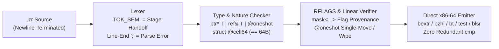
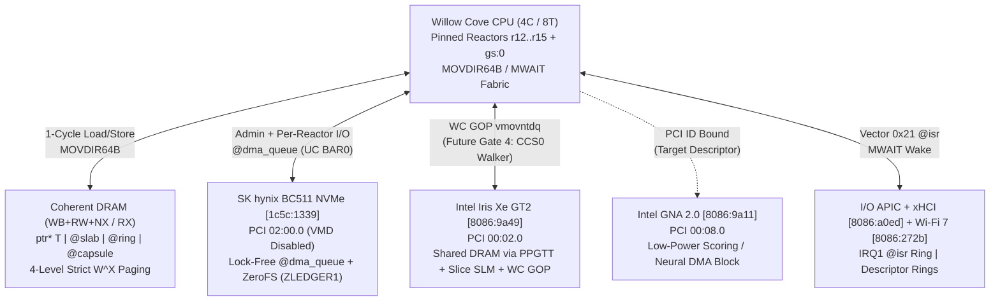
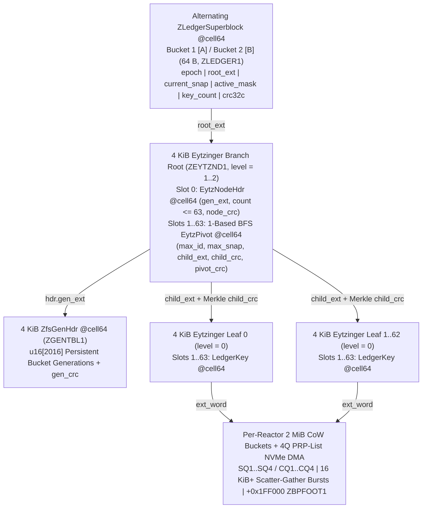

# `Zero` Next-Generation Language Spine & `ZeroFS` (`ZLEDGER1`) Specification

> [!IMPORTANT]
> **Document Status — Stages 1, 2A & 2B Scale-Out ALL Implemented & Verified (`108 PASS / 0 FAIL`):**
> Every subsystem defined in this specification is **100% lowered, self-hosted, and verified** (`build/zero2 == build/zero3` at `653,982 B`, `make clean && make test && make usb-img`):
> - **Stage 1 (`compiler/*.zr`) — IMPLEMENTED & VERIFIED:** The Next-Generation `Zero` Language Spine (`ptr*`, `ref&`, `ptr* @oneshot`, `struct ... [@cell64 | @packed]` with `T[N]`, inline `;` flag-handoff, `mask<...>`, `when` / `with ... ; when` / `with when` / `when while` / `when for`, `@ring(start .. len)`, and `@bits`), verified in `tests/phase5_nextgen_spine.zr` and Ring-0 `cap_spine_probe.zcap`.
> - **Stage 2A & 2B Scale-Out (`compiler/*.zr` + `examples/os/zerofs_ledger.zr` + `examples/os/hw_domains.zr` + `examples/os/nvme_capsule.zr`) — IMPLEMENTED & VERIFIED:** Non-POSIX hardware `@domain` bindings (`nvme`, `gt`, `gna`, `xhci`, `net`; `npu` rejected at compile time on Tiger Lake), `128-bit XMM` `@sha256_tag` (`SHA-NI`) & `@aes128_ctr64` (`AES-NI`) with immediate `pxor` XMM wipes, and the **Scale-Out `ZeroFS` (`ZLEDGER1`) Copy-on-Write NVMe Engine**:
>   - **Multi-Level (`level 0..2`) 1-Based Eytzinger Merkle-`CRC32C` B+Tree (`63 -> 3,969 -> 250,047` keys)** with inclusive `(max_id, max_snap)` `EytzPivot @cell64` routing and parent-held `child_crc` Merkle verification.
>   - **Cold-Reboot Persistent Generational GC:** On-disk `4 KiB` `ZfsGenHdr @cell64` (`ZGENTBL1`, `u16[2016]` bucket generations) + per-bucket `+0x1FF000` `ZfsBucketFooterHdr @cell64` (`ZBPFOOT1`, `126` × `ZfsBackpointer32`) surviving full RAM/power cycles.
>   - **Lockless Multi-Queue (`SQ1..SQ4`) + `PRP-List` Scatter-Gather NVMe DMA:** Up to `4` per-reactor NVMe I/O `@dma_queue` pairs (`64 B`-isolated `NvmeQueueSeq[4]`) + `MDTS`-aware `PRP1` / `PRP1+PRP2` / `PRP1 + 4 KiB PRP-List` multi-page bursts, strictly guarded by the double `ZLEDGER1` + `@crc32c` + `byte_off >= 2 MiB` write interlock (`0` writes to foreign drives).
>
> Per the **Zero Honesty Rule**, future Gate-4 items (`<tile: Size>`, `@cold` struct splitting, and `Iris Xe` `8086:9a49` Gen12LP EU compute execution) remain explicitly marked unimplemented until lowered and verified.

---

## Table of Contents

1. [Architectural Axioms & Rejected Anti-Patterns (Mandatory Agent Guide)](#1-architectural-axioms--rejected-anti-patterns-mandatory-agent-guide)
2. [Stage 1 Specification — The Next-Generation `Zero` Language Spine](#2-stage-1-specification--the-next-generation-zero-language-spine)
   - [2.1 Core Syntactic Spine, Block Law & Semicolon Flag-Handoff Law](#21-core-syntactic-spine-block-law--semicolon-flag-handoff-law)
   - [2.2 Sigil Separation: `ptr* T` and `ref& T`](#22-sigil-separation-ptr-t-and-ref-t)
   - [2.3 Structural Declarations, Fixed Arrays & The `@` Nature Law](#23-structural-declarations-fixed-arrays--the--nature-law)
   - [2.4 Ephemeral Register-Only Pointers: `ptr* @oneshot T`](#24-ephemeral-register-only-pointers-ptr-oneshot-t)
   - [2.5 Hardware Mask Engine (`mask<...>`) & Zero-`cmp` `RFLAGS` Fusion](#25-hardware-mask-engine-mask--zero-cmp-rflags-fusion)
   - [2.6 Bitwise Control Flow (`when`, `with when`, `when while`, `when for`) & `@ring` / `@bits`](#26-bitwise-control-flow-when-with-when-when-while-when-for--ring--bits)
   - [2.7 Canonical Stage-1 Reference Program (Golden Contract)](#27-canonical-stage-1-reference-program-golden-contract)
   - [2.8 Expected `x86-64` Machine-Code Lowering Walkthrough](#28-expected-x86-64-machine-code-lowering-walkthrough)
   - [2.9 Stage-1 Verification & Negative-Probe Matrix](#29-stage-1-verification--negative-probe-matrix)
3. [Stage 2 Specification — Non-POSIX Hardware Domains & `ZeroFS` (`ZLEDGER1`)](#3-stage-2-specification--non-posix-hardware-domains--zerofs-zledger1)
   - [3.1 Monolithic Kernel Without "Everything Is a File" (`i7-1165G7` Silicon Map)](#31-monolithic-kernel-without-everything-is-a-file-i7-1165g7-silicon-map)
   - [3.2 On-Disk Coexistence & The `ZLEDGER1` Partition Safety Guard](#32-on-disk-coexistence--the-zledger1-partition-safety-guard)
   - [3.3 The 64-Bit `ExtentWord` & Adaptive `000..111` Piece Engine](#33-the-64-bit-extentword--adaptive-000111-piece-engine)
   - [3.4 2 MiB Append-Only Generational Buckets & Backpointers](#34-2-mib-append-only-generational-buckets--backpointers)
   - [3.5 Eytzinger `CRC32C` B-Tree, Snapshots & Lockless Per-Reactor Sharding](#35-eytzinger-crc32c-b-tree-snapshots--lockless-per-reactor-sharding)
   - [3.6 Opt-In Seekable `128-Bit XMM` `AES-NI` + `SHA-NI` Block Locking & $O(1)$ Search](#36-opt-in-seekable-128-bit-xmm-aes-ni--sha-ni-block-locking--o1-search)

---

## 1. Architectural Axioms & Rejected Anti-Patterns (Mandatory Agent Guide)

Future engineers and AI agents working on `compiler/*.zr` or `examples/os/*.zr` **must** internalize both the hardware budget of `x86-64` Tiger Lake silicon and the explicit design decisions below before touching any syntax or codegen path.

### 1.1 Silicon Budget Laws (`Intel Core i7-1165G7` Willow Cove)

| Dimension | Hardware Reality on `x86-64` Willow Cove | Enforced `Zero` / `ZeroOS` Engineering Law |
| :--- | :--- | :--- |
| **Pointer Width** | `16` GPRs (`4` pinned to Reactor ABI `r12..r15`, `rsp`/`rbp` reserved $\rightarrow$ `10` general scratch/callee GPRs); `64 B` L1D cacheline. | **All addresses and extent descriptors (`ptr* T`, `ExtentWord`) are strictly 64-bit (`8 B`).** Eight fit per `64 B` cacheline (`1` GPR each). Default 128-bit fat pointers are **forbidden** (they halve cacheline pointer density and starve GPR allocation).Bounded 16-byte slices (`[]T`, `@view<T>(a, n)`) remain explicit view types. |
| **Register Tiering** | `64-bit` GPR (`1`-cycle ALU/BMI), `128-bit` `XMM` (`AES-NI`/`SHA-NI` at zero clock penalty), `512-bit` `ZMM` (`EVEX`, high bulk throughput inside `<tile>`). | **Surgical register tiering:**<br>1. **64-bit GPRs** drive pointers, `mask<...>`, `RFLAGS` branches, and B-tree probes.<br>2. **128-bit `XMM` (`AES-NI` / `SHA-NI`)** runs seekable 64-byte cacheline encryption/authentication with zero `AVX-512` power/frequency cost.<br>3. **512-bit `ZMM` (`u32x16` / `u64x8`)** is reserved for bulk data-parallel `<tile>` loops and `vmovntdq` scanout. |
| **Address Tagging** | `/proc/cpuinfo` confirms Intel **LAM (`Linear Address Masking`) is absent** on Tiger Lake (`39-bit` physical, `48-bit` canonical virtual). | `ptr* T` holds an untagged canonical 64-bit virtual address (`0` masking overhead on dereference). Metadata-rich storage handles (`ExtentWord`) pack bits `[63:42]` and extract `[41:0]` in `1` cycle via `mask<ext \| ADDR42_MASK> << 6` (`bzhi` + `shl`). |
| **CPU Flags (`RFLAGS`)** | `and`, `test`, `bt`, `bextr`, `bzhi`, `blsr`, `tzcnt`, and `dec` already compute `ZF` / `CF` in hardware. | **Zero redundant `cmp` / `sete`:** Control constructs (`when`, `with ... ; when`, `with when`, `when while`, `when for`) consume `ZF`/`CF` directly from `mask<...>` without materializing intermediate `u8` booleans or redundant `cmp reg, 0` instructions. |

### 1.2 Explicitly Rejected Syntactic Anti-Patterns (Do Not Re-Introduce)

During language design, three approaches were evaluated and **permanently rejected**:

1. **NO OOP Pointer Wrapper Classes (`ptr Name<T> { on_read ... fn ... }`):**
   Wrapping pointers inside class/trait-like method blocks turns systems code into verbose C++/Rust boilerplate without expressing hardware register, flag, or lifecycle laws.
2. **NO Brace-Less Indentation-Only "Beat" Columns:**
   Eliminating `fn`, `struct`, `return`, and `{ }` in favor of whitespace-sensitive keyword columns hurts structural clarity in deep kernel/filesystem state machines. `Zero` keeps `fn`, `struct`, `return`, `{ }` for multi-statement blocks, and `=>` for single-action arms.
3. **NO `@place` Suffixes Glued Onto Types/Registers (`x: u64@r12`, `p: u64[]@shot`, `place gt`):**
   `@` is **never** a location sigil glued onto arbitrary identifiers or CPU register names. `@` denotes **exclusively** specialized hardware/structural natures (`@oneshot`, `@ring`, `@bits`, `@slab`, `@arena`, `@capsule`, `@cell64`, `@packed`) and compiler intrinsics (`@crc32c`, `@rdtsc`, etc.).

---

## 2. Stage 1 Specification — The Next-Generation `Zero` Language Spine



### 2.1 Core Syntactic Spine, Block Law & Semicolon Flag-Handoff Law

1. **Keywords & Block Delimiters:**
   - Functions, structures, and explicit early/final returns use `fn`, `struct`, and `return`.
   - **`{ ... }`** encloses any body containing more than one statement (functions, structs, multi-statement branches, loops).
   - **`=>`** introduces a single-statement arm (`when scale == 0 => return len11`, `when ZF => fail FAULT_CORRUPT`, `fn square(x: u64) u64 => x * x`).
2. **Statement Termination:**
   - Newlines (or closing `}`) terminate statements naturally.
3. **The Semicolon (`;`) Flag-Handoff Law:**
   - `;` is **strictly an inline hardware stage-to-consumer handoff operator** connecting a bitwise/mask/guard stage to the consumer of the `RFLAGS` or loop iteration it just prepared:
     - `with pcs := mask<ext | PIECES_BITS> >> 46 ; when ZF { ... }`
     - `with when mask<ext | CRYPT_BIT> ; !ZF { ... }`
     - `settled := mask<doorbell_status[0] | READY_PHASE | until !ZF ; max 65536>`
     - `when batch_len > 0 ; for slot, ticket in io_wheel @ring(start_seq .. batch_len) { ... }`
     - `when for idx in 0..5 ; mask<cur_node[0].pieces[idx] | ADDR42_MASK> != 0 { ... }`
     - `when while next_raw := mask<cur_node[0].next_ext | ADDR42_MASK> ; !ZF { ... }`
   - **Hard Rejection Rule:** A `;` appearing at the end of a statement/line (before `\n`, `//`, `}`, or `EOF`) is a **hard compile-time parse error**. *(Audit note: 0 existing `.zr` files in `compiler/`, `examples/`, or `tests/` contain `;` outside comments, ensuring 100% backwards compatibility.)*

---

### 2.2 Sigil Separation: `ptr* T` and `ref& T`

`*` is reserved exclusively for multiplication (`imul`). `&` is reserved exclusively for bitwise AND (`and`) and short-circuit `&&`. Pointer and reference types use two-character compound type words:

| Form | Byte Width | Runtime Representation | Semantics & Lowering Rules |
| :--- | :---: | :--- | :--- |
| **`ptr* T`** | `8 B` | Canonical 64-bit virtual address in `1` GPR or `[rbp - disp]` slot | Classic raw typed pointer to `T`.<br>• **Indexing / Dereference:** `p[0]` loads `T` at `[p]`; `p[i]` scales by `@sizeof(T)` (`[p + i * sizeof(T)]`); `p[i] = val` stores.<br>• **Pointer Arithmetic:** `arena + offset` where `arena : ptr* u8` computes `lea` (`byte_stride = sizeof(T)`).<br>• **Explicit Cast:** `ptr* PieceHeader32 (arena + base_off)` reinterprets an integer/byte-pointer address expression as `ptr* PieceHeader32` (`0` instructions). |
| **`ref& T`** | `0 B` *(in source semantics; ABI passes caller slot address in argument GPR)* | Zero-copy alias to an existing caller variable (`out_bytes : ref& u64`) | Non-null, non-rebindable reference to a caller lvalue.<br>• **Call Site:** Passing a mutable variable `seen_bytes` to `out_bytes : ref& u64` automatically passes `lea reg, [rbp - disp]` without sigil noise at the call site; passing an rvalue expression or `@oneshot` variable is a **compile error**.<br>• **Inside Callee:** `out_bytes = val` writes straight through the hidden address to the caller's stack/slab slot; reading `out_bytes` loads `[reg]`. Cannot be null, indexed (`out_bytes[1]` is an error), or reassigned to alias a different slot. |

---

### 2.3 Structural Declarations, Fixed Arrays & The `@` Nature Law

1. **`struct` Declarations & Layout Natures:**
   Both existing `Name :: { ... }` declarations (for full backwards compatibility across `compiler/` and `examples/`) and the first-class `struct` spine are supported:
   ```zr
   struct PieceHeader32 {
       exact_len : u64
       key_tag   : u64
       p0        : u64
       p1        : u64
   }

   struct ExtentChain64 @cell64 {
       exact_len : u64
       key_tag   : u64
       pieces    : u64[5]
       next_ext  : u64
   }

   struct RawDiskSuper @packed {
       magic     : u64
       version   : u32
       flags     : u16
   }
   ```
   - **Fixed-Size Inline Array Fields (`T[N]`):** `pieces : u64[5]` embeds `N * @sizeof(T)` contiguous bytes directly inside the struct (`offset` aligned to `@alignof(T)` unless `@packed`). Field indexing `node.pieces[idx]` or `cur_node[0].pieces[idx]` lowers to `base + field_off + idx * sizeof(T)` with compile-time/runtime bounds awareness (`0 <= idx < N`).
   - **Strict `@cell64` 64-Byte Invariant:** A `struct Name @cell64` represents a hardware cacheline / `MOVDIR64B` transport unit. Its alignment is forced to `64 B`, and **`@sizeof(Name)` MUST equal `64` bytes** (`IoTicket` with `5 * 8 + 2 * 4 + 2 * 8 = 64 B` passes; a 48-byte or 72-byte `@cell64` struct under the `struct ... @cell64` form is a **compile-time size error**).

2. **Topological Space Bracket Syntax (`T[Cap]`):**
   In addition to legacy `<T | max: N>` / `<T | cap: N>`, topological spaces accept concise array-capacity notation:
   ```zr
   @slab    vault_arena : u8[262144]     // 256 KiB RW+NX static slab, bounds-checked (fail 2)
   @slab    lane_out    : u64[64]        // 64 x u64 RW+NX static slab
   @ring    io_wheel    : IoTicket[16]   // Power-of-2 ring of 64B @cell64 tickets (1024 B, 64B-aligned)
   @capsule code_vault  : u8[65536]      // 4 KiB page-aligned 64 KiB W^X sealable capsule region
   ```
   - `@ring` requires power-of-2 capacity (`cap & (cap - 1) == 0`).
   - `@capsule` enforces `u8[ByteCap]` (4 KiB page-aligned capacity).

3. **Closed Set of `@` Natures:**
   `@` may only prefix:
   - **Pointer/Iteration Natures:** `@oneshot`, `@ring`, `@bits` (plus legacy `@ptr`, `@view`, `@mmio`, `@stream`, `@atomic`, `@span`).
   - **Topological/Struct Natures:** `@slab`, `@arena`, `@capsule`, `@dma_queue`, `@port`, `@cell64`, `@packed`, `@isr`, `@isr_ok` (`@cold` remains explicitly rejected until lowered).
   - **Built-in Silicon Intrinsics:** `@crc32c`, `@popcnt`, `@lzcnt`, `@tzcnt`, `@pdep`, `@pext`, `@bswap16/32/64`, `@vec_*`, `@rdtsc`, `@reactor_id`, etc.

---

### 2.4 Ephemeral Register-Only Pointers: `ptr* @oneshot T`

`ptr* @oneshot T` is an **ephemeral, single-consumption, hardware-wiped register capability** designed for cryptographic key material, unlocked secret blocks, and one-time DMA/completion descriptors where **no trace of the address may ever land in RAM or linger in a CPU register after use**.

```mermaid
stateDiagram-v2
    [*] --> LIVE_IN_GPR_A : "secret_p : ptr* @oneshot T = addr_expr\n(Allocated in dedicated GPR R_a; 0 stack bytes)"
    LIVE_IN_GPR_A --> RELAYED_TO_GPR_B : "shown : ptr* @oneshot T = secret_p\nEmits: mov R_b, R_a + xor R_a, R_a\n(secret_p -> DEAD)"
    LIVE_IN_GPR_A --> WIPED_TERMINAL : "val := secret_p[0]  OR  secret_p[0] = v\nEmits: mov/store + xor R_a, R_a\n(secret_p -> DEAD)"
    RELAYED_TO_GPR_B --> WIPED_TERMINAL : "val := shown[0]  OR  shown[0] = v\nEmits: mov/store + xor R_b, R_b\n(shown -> DEAD)"
    WIPED_TERMINAL --> [*]
```



#### Exact Hardware & Typechecker Laws for `ptr* @oneshot T`

1. **Zero Stack Allocation (`[rbp - disp]` Forbidden):**
   - A `ptr* @oneshot T` local variable **never** increments `G_FRAME_QW` and never receives a stack frame offset. It is bound directly to a dedicated register from the function's non-pinned register pool (e.g., `r11`, `r10`, `r9`, `r8`, `rcx`, or `rbx` — never `r12..r15` on Reactor ABI targets).
2. **One Legal Register-to-Register Relay (`mov` + Immediate `xor` Wipe):**
   - Initializing a new `ptr* @oneshot T` from an existing live `ptr* @oneshot T`:
     ```zr
     secret_p : ptr* @oneshot u64 = arena + base_off + 64
     shown    : ptr* @oneshot u64 = secret_p
     ```
     allocates a distinct register `R_dst` (`!= R_src`), emits:
     ```nasm
     mov  R_dst, R_src      ; hand off capability to R_dst
     xor  R_src32, R_src32  ; architectural 64-bit zeroing of R_src in the exact same pair!
     ```
     and immediately marks `secret_p` **`CONSUMED`** in the symbol table.
3. **One Legal Terminal Dereference (`load`/`store` + Immediate `xor` Wipe):**
   - Dereferencing `shown[idx]` (for load `plain_word := shown[0] ^ caller_key` or store `shown[0] = v`) computes the memory access into a distinct result register `R_val` (`!= R_ptr`), **immediately emits `xor R_ptr32, R_ptr32`** before any subsequent expression evaluation, and marks `shown` **`CONSUMED`**:
     ```nasm
     mov  rax, qword [r11]  ; single memory load from oneshot address in r11
     xor  r11d, r11d        ; r11 wiped to 0 immediately — address no longer exists anywhere!
     xor  rax, rdx          ; plain_word := rax ^ caller_key (data only, not the address)
     ```
4. **Compile-Time Rejection Rules (All Hard Errors):**
   - **Escape to Plain Pointer:** `leak : ptr* u64 = secret_p` or passing `secret_p` to a `ptr* T` parameter $\rightarrow$ **Compile Error** (*cannot downgrade `@oneshot` pointer to persistent `ptr*`*).
   - **Double Use:** Reading/relaying `secret_p` after it was already relayed to `shown` or dereferenced $\rightarrow$ **Compile Error** (*`@oneshot` pointer already consumed*).
   - **Call-Clobber / Spill Hazard:** Keeping a `ptr* @oneshot T` live across a `call` / `@call` / `syscall` (which could clobber caller-saved GPRs or force a stack spill) $\rightarrow$ **Compile Error** (*`@oneshot` pointer cannot live across function call*).
   - **Unconsumed Exit / Asymmetric Branch:** Exiting a block, `return`, `break`, `continue`, or `fail` while a `ptr* @oneshot T` has neither been consumed nor wiped (or consuming it in only one arm of `if`/`when`) $\rightarrow$ **Compile Error** (*unconsumed `@oneshot` capability*).
   - **Address-Of / `ref&`:** Passing a `ptr* @oneshot T` to a `ref&` parameter $\rightarrow$ **Compile Error** (*`@oneshot` has no memory address*).

---

### 2.5 Hardware Mask Engine (`mask<...>`) & Zero-`cmp` `RFLAGS` Fusion

`mask<...>` is a first-class silicon bit-inspection primitive that selects the optimal `x86-64` instruction (`bextr`, `bzhi`, `and`, `test`, `bt`) at compile time from the shape of the mask constant `M` and leaves hardware `RFLAGS` (`ZF` or `CF`) live for immediate consumption without emitting `cmp`.

#### Complete `mask<...>` Instruction-Selection & Flag Matrix

Let `M` be a compile-time non-zero `u64` constant with trailing zeros `S = ctz(M)` and population count `W = popcnt(M)`. `M` is **contiguous** iff `(M >> S) == ((1 << W) - 1)` (or `W == 64`).

| Source Pattern | Mask Shape & Context | Emitted `x86-64` Instruction(s) | Result Value | Live Flag Set |
| :--- | :--- | :--- | :--- | :---: |
| `mask<x \| M>` | **Low contiguous field** (`S == 0`, `1 <= W < 64`, e.g. `ADDR42_MASK = 0x3FF_FFFF_FFFF`) | `mov edx, W`<br>`bzhi rax, r_x, rdx` *(or `bextr rax, r_x, rdx` with `start=0, len=W`)* | `x & M` (low `W` bits) | **`ZF`** (`1` iff extracted field is `0`) |
| `mask<x \| M> >> S` | **Shifted contiguous field fused with matching right shift** (`S > 0`, contiguous `W`, shift `== S`, e.g. `mask<ext \| PIECES_BITS> >> 46`) | `mov edx, (W << 8) \| S`<br>`bextr rax, r_x, rdx` *(BMI1 `VEX.LZ.0F38.W1 F7` — **1 instruction fuses mask + shift!**)* | `(x & M) >> S` (shifted down to bit `0`) | **`ZF`** (`1` iff extracted field is `0`) |
| `mask<x \| M>` | **Unshifted high contiguous field (`S > 0`) OR scattered bits** (value kept, e.g. `mask<ext \| PERM_BITS>` without `>>`) | `mov rdx, M` *(or `imm32` if `M <= 0x7FFF_FFFF`)*<br>`and rax, rdx` | `x & M` (original bit positions intact!) | **`ZF`** (`1` iff `(x & M) == 0`) |
| `mask<x \| M>` *(in boolean/branch context `== 0`, `!= 0`, or `; ZF` / `; !ZF` where result value is unused)* | **Single bit (`W == 1`) or general mask `M`**, flag-only consumer | `test r_x, imm32` *(if `M` fits `imm32`)* or `mov rdx, M; test r_x, rdx` *(or `bt` — Note: `test` sets `ZF` without modifying `r_x`!)* | *(Value unused; `r_x` preserved)* | **`ZF`** (`1` iff `(x & M) == 0`) |
| `mask<x \| ONE_BIT> ; CF` / `; !CF` | **Single bit (`W == 1`, bit index `B = ctz(M)`)** with explicit `CF` handoff | `bt r_x, B` (`0F BA /4 ib`) | *(Value unused; `r_x` preserved)* | **`CF`** (`1` iff bit `B` of `x` is `1`) |
| `mask<lval \| M \| until !ZF ; max N>` | **3-part bounded volatile hardware poll** (`lval` must be memory/pointer/MMIO dereference, e.g. `doorbell_status[0]`; `N > 0`) | ```nasm
mov ecx, N
.spin:
mov eax, dword [r_ptr] ; volatile reload!
and eax, M             ; sets ZF (0 when ready)
jnz .ready             ; exit early with ZF=0!
pause                  ; F3 90 (SMT-friendly)
dec rcx                ; sets ZF=1 when rcx==0!
jnz .spin
.ready:
``` | Last masked `lval & M` in `rax` (`0` on timeout, non-zero on ready) | **`ZF`**<br>• `ZF = 0` if `until !ZF` succeeded<br>• **`ZF = 1` if all `N` spins expired** (set directly by final `dec rcx`!) |

> [!WARNING]
> **Critical `x86-64` `BMI1 bextr` Trap Avoided by This Spec:**
> On Intel `x86-64`, `bextr dst, src, ctrl` extracts `[start + len - 1 : start]` **and shifts those bits down to bit 0** (`dst = (src >> start) & ((1 << len) - 1)`). Therefore:
> - `bextr` **must** be emitted for `S == 0` (`mask<ext | ADDR42_MASK>`) and for fused `mask<ext | PIECES_BITS> >> 46` (`shift == ctz(M)`).
> - `bextr` **must NOT** be emitted for an unshifted high mask whose bit positions are kept (e.g., if code wrote `flags := mask<ext | PERM_BITS>` expecting bit `42` to stay at bit `42`); that case emits `and`, which preserves bit positions while still setting `ZF`.

#### Zero-`cmp` Comparison & `RFLAGS` Liveness Laws

1. **Zero-`cmp` Equality Against Zero:**
   - `mask<x | M> == 0` and `mask<x | M> != 0` **never emit a `cmp` instruction**. They branch directly (`jz` / `jnz`) off the `ZF` already produced by `bextr`/`bzhi`/`and`/`test`.
   - Comparing `mask<x | M>` against any **non-zero** constant `K != 0` (e.g., `mask<x | M> == 4`) emits a real `cmp` instruction.
2. **Compile-Time `RFLAGS` Liveness Tracking:**
   - After `settled := mask<doorbell_status[0] | READY_PHASE | until !ZF ; max 65536>`, the compiler records `LIVE_FLAG = ZF` (provenance: `settled`).
   - If the immediately following statement is `when ZF => ...` or `when !ZF => ...`, it emits `jz` / `jnz` directly (`0` `cmp`/`test` instructions) and consumes `LIVE_FLAG`.
   - If **any** flag-clobbering statement (`+=`, arithmetic, function call, non-trivial store) intervenes before `when ZF`, referencing bare `ZF` / `!ZF` is a **hard compile-time error** (*dead CPU flag `ZF`: clobbered before `when`*).
   - Naming an incompatible flag after `;` (e.g., `mask<x | MULTI_BIT_MASK> ; CF` where `popcnt(M) != 1`) is a **hard compile-time error**.

---

### 2.6 Bitwise Control Flow (`when`, `with when`, `when while`, `when for`) & `@ring` / `@bits`

Every conditional and loop construct in the new spine maps 1-to-1 onto compact assembly branch topologies:

| Construct | Exact Syntax | Machine Lowering & Semantics |
| :--- | :--- | :--- |
| **`when` (Single-Arm Guard)** | `when cond => stmt`<br>`when cond { ... }` | Evaluates `cond` directly into a jump target (no `else` branch unless `with when`). If `cond` is `mask<...> == 0`, `mask<...> != 0`, or bare live `ZF`/`!ZF`/`CF`/`!CF`, emits **0 `cmp`** instructions. |
| **`with ... ; when` (Stage-Bound Flag Branch)** | `with v := expr ; when FLAG { ... } [else { ... }]` | Evaluates `expr` (such as `mask<ext \| PIECES_BITS> >> 46` via `bextr`), binds `v` in an enclosing lexical scope, and branches immediately on `FLAG` (`ZF`, `!ZF`, `CF`, `!CF`) set by `expr` (`0` `cmp`). `v` remains usable both inside and after the `when` block if `when` does not return! |
| **`with when` (Anonymous Mask-to-Flag Scope)** | `with when mask<x \| M> ; FLAG { ... } [else { ... }]` | Emits flag-setting `test` (for `; ZF`/`!ZF`) or `bt` (for `; CF`/`!CF`) on `x` and `M`, then branches straight into the `{ ... }` (and optional `else { ... }`) block (`0` `cmp`, `0` wasted destination register). |
| **`when cond ; for ...` (Guarded Loop)** | `when cond ; for i, item in ... { ... }` | Emits outer guard test `cond`; if false, jumps cleanly past loop setup and body (`1` forward branch around the loop). |
| **`when for ... ; filter` (Filtered Range Loop)** | `when for idx in lo..hi ; filter_cond { ... }` | Iterates `idx` over `[lo, hi)`. At the top of each iteration, evaluates `filter_cond` (e.g. `mask<arr[idx] \| ADDR42_MASK> != 0` $\rightarrow$ `bzhi`/`test` + `jz .next`, `0` `cmp`) and skips directly to `.next` (`inc idx`) when false. |
| **`when for b in word @bits` (Hardware Bit-Scan Loop)** | `when for lane in mask_expr @bits { ... }` | Copies `mask_expr` (`u64`) into loop carrier `r_mask`:<br>1. `test r_mask, r_mask; jz .done`<br>2. `.loop: tzcnt r_lane, r_mask` (`F3 48 0F BC` — index `0..63` of lowest set bit)<br>3. Executes body with immutable `lane : u64`<br>4. `.next: blsr r_mask, r_mask; jnz .loop` (`BMI1 VEX.NDD.LZ.0F38.W1 F3 /1` clears lowest set bit *and* sets `ZF=1` when `r_mask` hits `0` — **zero `cmp`!**). |
| **`for slot, elem in r @ring(start .. len)` (Cyclic Ring Walk)** | `for slot, item in ring_sp @ring(start_seq .. batch_len) { ... }` | Requires `ring_sp` to be an `@ring` space of power-of-2 capacity `C = 2^k`. Evaluates `start_seq` and `batch_len` once:<br>• Loop step `step` runs `0 .. batch_len` (`cmp step, batch_len; jae .done`).<br>• `slot : u64 = (start_seq + step) & (C - 1)` (`lea` + `1` `and` instruction!).<br>• `item` binds to `ring_sp[slot]` (64B `@cell64` overlay/value without redundant bounds fault because `& (C - 1)` guarantees `slot < C`). |
| **`when while` (Mask-Driven Hardware Loop)** | `when while v := mask<...> ; !ZF { ... }` | Loop header evaluates `v := mask<...>` (`bzhi`/`bextr`/`and`) on every iteration, branching directly to `.exit` when `ZF == 1` (`jz .exit`, **zero `cmp`**), and binds `v` inside the loop body before jumping back to `.hdr`. |

---

### 2.7 Canonical Stage-1 Reference Program (Golden Contract)

Every construct, type layout, `@oneshot` relay/wipe, `mask<...>` flag handoff, `@ring` traversal, and `@bits` walk in the following 135-line program **must compile verbatim under self-hosted `build/zero2` (`zero2 == zero3`)** and pass both execution and `objdump` opcode verification in Stage 1:

```zr
PERM_BITS     :: 0b11 << 42
WRITE_BIT     :: 1 << 43
CRYPT_BIT     :: 1 << 44
PIECES_BITS   :: 0b111 << 46
ADDR42_MASK   :: 0x0000_03FF_FFFF_FFFF
READY_PHASE   :: 1

FAULT_DENIED  :: 4
FAULT_CORRUPT :: 5

struct PieceHeader32 {
    exact_len : u64
    key_tag   : u64
    p0        : u64
    p1        : u64
}

struct ExtentChain64 @cell64 {
    exact_len : u64
    key_tag   : u64
    pieces    : u64[5]
    next_ext  : u64
}

struct IoTicket @cell64 {
    seq       : u64
    lane_mask : u64
    ext_word  : u64
    key_hash  : u64
    dst_off   : u64
    crc       : u32
    flags     : u32
    pad       : u64[2]
}

@slab    vault_arena : u8[262144]
@slab    lane_out    : u64[64]
@ring    io_wheel    : IoTicket[16]
@capsule code_vault  : u8[65536]

fn decode_end(ext: u64) u64 {
    scale := (ext >> 61) & 0b111
    len11 := (ext >> 50) & 0x7FF
    when scale == 0 => return len11
    return len11 << (scale * 3 + 3)
}

fn unlock_secret_block(
    arena      : ptr* u8,
    ext        : u64,
    caller_key : u64,
    out_bytes  : ref& u64
) u64 {
    when mask<ext | PERM_BITS> == 0 => fail FAULT_DENIED

    base_off := mask<ext | ADDR42_MASK> << 6
    hdr      := ptr* PieceHeader32 (arena + base_off)

    with when mask<ext | CRYPT_BIT> ; !ZF {
        when caller_key == 0 || hdr[0].key_tag != caller_key => fail FAULT_DENIED

        secret_p : ptr* @oneshot u64 = arena + base_off + 64
        shown    : ptr* @oneshot u64 = secret_p
        out_bytes = hdr[0].exact_len
        plain_word := shown[0] ^ caller_key
        return plain_word
    }

    out_bytes = decode_end(ext)
    raw_q := ptr* u64 (arena + base_off)
    return raw_q[0]
}

fn fold_extent_pieces(arena: ptr* u8, ext: u64, total_out: ref& u64) u64 {
    when mask<ext | PERM_BITS> == 0 => fail FAULT_DENIED

    with pcs := mask<ext | PIECES_BITS> >> 46 ; when ZF {
        total_out = decode_end(ext)
        direct_p := ptr* u64 (arena + (mask<ext | ADDR42_MASK> << 6))
        return direct_p[0]
    }

    base_addr := arena + (mask<ext | ADDR42_MASK> << 6)

    when pcs <= 3 {
        h32 := ptr* PieceHeader32 (base_addr)
        total_out = h32[0].exact_len
        a := ptr* u64 (arena + (mask<h32[0].p0 | ADDR42_MASK> << 6))
        b := ptr* u64 (arena + (mask<h32[0].p1 | ADDR42_MASK> << 6))
        return a[0] ^ b[0]
    }

    cur_node := ptr* ExtentChain64 (base_addr)
    total_out = cur_node[0].exact_len
    acc : u64 = 0

    when for idx in 0..5 ; mask<cur_node[0].pieces[idx] | ADDR42_MASK> != 0 {
        seg_off := mask<cur_node[0].pieces[idx] | ADDR42_MASK> << 6
        seg_p   := ptr* u64 (arena + seg_off)
        acc ^= seg_p[0]
    }

    when while next_raw := mask<cur_node[0].next_ext | ADDR42_MASK> ; !ZF {
        cur_node = ptr* ExtentChain64 (arena + (next_raw << 6))
        seg0 := ptr* u64 (arena + (mask<cur_node[0].pieces[0] | ADDR42_MASK> << 6))
        acc ^= seg0[0]
    }

    return acc
}

fn await_dma_phase(doorbell_status: ptr* u32) u32 {
    settled := mask<doorbell_status[0] | READY_PHASE | until !ZF ; max 65536>
    when ZF => fail FAULT_CORRUPT
    return settled
}

fn drain_reactor_wheel(
    status_reg : ptr* u32,
    start_seq  : u64,
    batch_len  : u64,
    active_key : u64,
    completed  : ref& u64
) u64 {
    _ := await_dma_phase(status_reg)
    arena_p : ptr* u8 = vault_arena.base
    digest  : u64     = 0
    done    : u64     = 0

    when batch_len > 0 ; for slot, ticket in io_wheel @ring(start_seq .. batch_len) {
        when mask<ticket.ext_word | PERM_BITS> == 0 => continue

        when for lane in ticket.lane_mask @bits {
            lane_out[lane] ^= ticket.seq + slot
        }

        seen_bytes : u64 = 0
        with when mask<ticket.ext_word | CRYPT_BIT> ; !ZF {
            val := unlock_secret_block(arena_p, ticket.ext_word, active_key, seen_bytes)
            digest = @crc32c(digest, val ^ seen_bytes)
        } else {
            val := fold_extent_pieces(arena_p, ticket.ext_word, seen_bytes)
            digest = @crc32c(digest, val ^ seen_bytes)
        }

        done += 1
    }

    completed = done
    return digest
}
```

---

### 2.8 Expected `x86-64` Machine-Code Lowering Walkthrough

To prevent any ambiguity during `compiler/*.zr` implementation, the critical hotspots of the reference program above must lower to the following exact instruction shapes:

#### 1. `unlock_secret_block` — Zero-`cmp` Permission Gate, `bt`/`test`, and `@oneshot` Relay + Double Wipe
```nasm
; when mask<ext | PERM_BITS> == 0 => fail FAULT_DENIED
mov   rdx, 0x00000C0000000000   ; PERM_BITS (0b11 << 42)
test  rsi, rdx                  ; sets ZF directly (0 cmp!)
jz    .fault_denied

; base_off := mask<ext | ADDR42_MASK> << 6
mov   edx, 0x2A00               ; len = 42 (0x2A << 8), start = 0
bextr rax, rax, rdx             ; extract contiguous bits [41:0] in 1 BMI1 instruction
shl   rax, 6

; with when mask<ext | CRYPT_BIT> ; !ZF { ... }
mov   rdx, 0x0000100000000000   ; CRYPT_BIT (1 << 44)
test  rax, rdx                  ; sets ZF (0 cmp!)
jz    .plain_path               ; !ZF false -> skip encrypted block

; secret_p : ptr* @oneshot u64 = arena + base_off + 64
; (@oneshot GPR pool: slots 0..3 -> [r10, r9, rsi, rdi], 0 stack spill slots!)
add   rax, rcx                  ; arena + base_off (spill-free local RHS add)
add   rax, 64                   ; + 64 (spill-free immediate RHS add)
mov   r10, rax                  ; secret_p born in GPR r10 (NO [rbp-disp] slot!)
xor   eax, eax                  ; scrub staging GPR rax immediately!
; shown : ptr* @oneshot u64 = secret_p
mov   r9, r10                   ; legal 1-hop @oneshot relay from r10 -> r9
xor   r10d, r10d                ; IMMEDIATE architectural wipe of secret_p (r10 == 0)!
; out_bytes = hdr[0].exact_len  (writes directly through ref& pointer)
mov   rax, qword [r_hdr]
mov   qword [r_out_bytes], rax
; plain_word := shown[0] ^ caller_key
mov   rax, qword [r9]           ; single terminal dereference of shown
xor   r9d, r9d                  ; IMMEDIATE architectural wipe of shown (r9 == 0)!
xor   rax, r_caller_key
```

#### 2. `fold_extent_pieces` — Fused `BMI1 bextr` (`mask<ext | PIECES_BITS> >> 46 ; when ZF`)
```nasm
; with pcs := mask<ext | PIECES_BITS> >> 46 ; when ZF { ... }
mov   edx, 0x032E               ; len = 3 (0x03 << 8), start = 46 (0x2E)
bextr rax, rsi, rdx             ; ONE instruction extracts [48:46] >> 46 AND sets ZF!
mov   qword [rbp - disp_pcs], rax ; mov does NOT modify RFLAGS.ZF!
jnz   .multi_piece              ; ZF == 1 falls straight into fast 000 contiguous path (0 cmp!)
```

#### 3. `await_dma_phase` — 3-Part Volatile `mask<... | until !ZF ; max 65536>` + Zero-`cmp` Timeout
```nasm
; settled := mask<doorbell_status[0] | READY_PHASE | until !ZF ; max 65536>
mov   ecx, 65536
.spin:
mov   eax, dword [rdi]          ; volatile reload of doorbell_status[0] each iteration
and   eax, 1                    ; READY_PHASE; sets ZF=0 when ready!
jnz   .done_spin                ; ready -> jumps out with ZF=0 and eax == settled!
pause                           ; F3 90
dec   rcx                       ; decrements spin counter; sets ZF=1 when rcx hits 0!
jnz   .spin                     ; falls through ONLY on timeout, with ZF=1 live!
.done_spin:
; when ZF => fail FAULT_CORRUPT
jz    .fault_corrupt            ; ZERO cmp instructions — reads ZF directly!
```

#### 4. `drain_reactor_wheel` — `@ring(start_seq .. batch_len)` + `@bits` (`tzcnt` / `blsr`)
```nasm
; slot = (start_seq + step) & 15
lea   rax, [r_start + r_step]
and   eax, 15                   ; 1-cycle modulo wrap on power-of-2 @ring[16]

; when for lane in ticket.lane_mask @bits { lane_out[lane] ^= ticket.seq + slot }
mov   r8, qword [r_ticket + 8]  ; load ticket.lane_mask
test  r8, r8
jz    .bits_done
.bits_loop:
tzcnt r9, r8                    ; r9 = index of lowest set lane bit (0..63)
; ... lane_out[r9] ^= ticket.seq + slot ...
blsr  r8, r8                    ; clear lowest set bit in r8 AND set ZF=1 if r8 == 0!
jnz   .bits_loop                ; ZERO cmp instructions!
.bits_done:
```

---

### 2.9 Stage-1 Verification & Negative-Probe Matrix

Stage 1 is only complete when **`make clean && make test`** passes all existing 78 checks **plus**:

1. **Self-Hosting Fixed Point:** `build/zero2 == build/zero3` (`0` byte diff, strict `W^X` `ELF64`).
2. **Golden Execution & Disassembly Gate (`tests/phase5_nextgen_spine.zr`):**
   - Compiles and executes the **135-line canonical reference program verbatim** (exercising `000` single-piece, `001..011` `PieceHeader32`, `100..111` `ExtentChain64` multi-node chains, encrypted `CRYPT_BIT` unlock + key mismatch `FAULT_DENIED`, `await_dma_phase` ready + `FAULT_CORRUPT` timeout `recover`, `@ring` wrap-around across index `15 -> 0`, and `@bits` sparse lane updates).
   - Multi-algorithm stress suite combining Eytzinger branchless search, Robin-Hood/Swiss fingerprint probing, chained extent folding, and `@oneshot` capability relays.
   - `objdump` verification proving presence of `bextr`, `bzhi`, `blsr`, `tzcnt`, `pause`, `@oneshot` `xor` register wipes, and **absence of `cmp` between `mask<...>` and its `ZF` branch**.
3. **Mandatory New Negative Compile-Rejection Probes (Minimum 12 Probes):**
   - Trailing `;` at end of line $\rightarrow$ rejected.
   - `struct BadCell @cell64` with `@sizeof != 64` (e.g., `48` bytes) $\rightarrow$ rejected.
   - Assigning `ptr* @oneshot u64` to plain `ptr* u64` $\rightarrow$ rejected.
   - Dereferencing `ptr* @oneshot u64` twice $\rightarrow$ rejected.
   - Reading `secret_p` after relaying `shown : ptr* @oneshot u64 = secret_p` $\rightarrow$ rejected.
   - Holding a live `ptr* @oneshot u64` across a function `call` $\rightarrow$ rejected.
   - Leaving a `ptr* @oneshot u64` unconsumed at scope/function exit $\rightarrow$ rejected.
   - Passing an rvalue literal (`42`) or `@oneshot` variable to a `ref& u64` parameter $\rightarrow$ rejected.
   - Referencing `when ZF` after an intervening ALU statement clobbered `RFLAGS` $\rightarrow$ rejected.
   - Naming `; CF` on a multi-bit `mask<x | 0b11>` $\rightarrow$ rejected.
   - Using `@ring(start .. len)` on a non-`@ring` space $\rightarrow$ rejected.
   - Using `mask<scalar_var | M | until !ZF ; max N>` on a non-memory scalar register local (which could never change in a spin loop) $\rightarrow$ rejected.

---

## 3. Stage 2 Specification — Non-POSIX Hardware Domains & `ZeroFS` (`ZLEDGER1`)

### 3.1 Monolithic Kernel Without "Everything Is a File" (`i7-1165G7` Silicon Map)

`ZeroOS` is a **single-address-space Ring-0 monolithic kernel** (zero microkernel IPC tax, zero user/kernel `syscall`/`sysret` ring transitions on hot I/O paths, dynamically extensible via CRC32C-verified W^X `@capsule` modules). However, `ZeroOS` **completely abolishes the 1970s UNIX *"everything is a file"* illusion** (`open("/dev/...", O_RDWR)`, untyped `ioctl`, text path parsing, VFS dentry/inode locks).

Every physical subsystem discovered on the reference **Intel Core i7-1165G7** package (`lspci -nn` verified) is represented by its **true hardware physics**:



| Hardware Domain | Verified PCI / Bus Identity on Host | Memory & Command Physics | Compile-Time Type Separation |
| :--- | :--- | :--- | :--- |
| **`CPU` / Reactor** | `4` Willow Cove cores (`8` threads), `x2APIC` | Registers, `RFLAGS`, `gs:0` `ReactorLocal`, `64 B` `MOVDIR64B` inboxes | Pinned `r12..r15`, `@cell64` `publish` / `wait`, `<tile>` quanta |
| **`DRAM`** | `8086:9a14` Host Bridge (`39b` phys / `48b` virt) | Byte-addressable coherent volatile memory (`WB`) | `ptr* T`, `ref& T`, `ptr* @oneshot T`, `@slab`, `@ring`, `@capsule` |
| **`DISK` (`nvme`)** | `02:00.0` SK hynix BC511 NVMe `[1c5c:1339]` *(Intel VMD disabled; direct `MCFG` visibility)* | Asynchronous `64 B` `NvmeCmd` / `16 B` `NvmeCqe` `@dma_queue` rings + `ZeroFS` (`ZLEDGER1`) | Keyed `64-bit ExtentWord` / `LedgerKey` — **cannot** be dereferenced as `ptr* T` without staging into DRAM/`@capsule`! |
| **`GPU` (`gt`)** | `00:02.0` Iris Xe Graphics GT2 `[8086:9a49]` | Shares physical DRAM via its own **PPGTT** page table + private on-die **SLM** + `WC` GOP aperture | GOP scanout uses `@vec_stream` (`vmovntdq`); `gt` PPGTT descriptors are distinct from CPU `ptr* T` *(Gate 4 target)* |
| **`GNA` (`gna`)** | `00:08.0` Intel GNA 2.0 Scoring Accelerator `[8086:9a11]` | Dedicated MMIO + descriptor-driven low-power neural scoring *(Note: Tiger Lake has **no NPU**; Intel NPU begins on Meteor Lake)* | Naming an `npu` hardware target on Tiger Lake is a **hard compile-time error**; `gna` is the true silicon block |
| **`INPUT` / `NET`** | `isa0060` (`IRQ1`), `00:14.0` xHCI `[8086:a0ed]`, `01:00.0` Wi-Fi 7 `[8086:272b]` | Interrupt-driven `@ring`s and hardware descriptor queues | Direct typed ring cells (`kbd_ring`, packet descriptors) — zero stream/character-device emulation |

---

### 3.2 On-Disk Coexistence & The `ZLEDGER1` Partition Safety Guard

> [!CAUTION]
> **Mandatory Host & Bare-Metal Drive Protection Law (`ZLEDGER1` Magic Guard):**
> Both host tools and bare-metal `ZeroOS` NVMe write paths **MUST verify** before issuing any NVMe Write (`0x01`) or Flush (`0x00`) command that the target namespace/partition carries the exact 64-bit magic **`ZLEDGER_MAGIC = 0x3152_4547_4445_4C5A`** (`"ZLEDGER1"` in little-endian ASCII) **and** a valid hardware `@crc32c` superblock checksum. If an NVMe namespace contains `ext4`, `btrfs`, `FAT32`, `NTFS`, Linux LUKS, or an unformatted header (such as the host laptop's `1c5c:1339` Linux SSD), `ZeroFS` **immediately aborts write initialization in read-forbidden safe mode** (`0` sectors written).

#### Disk Layout (Unifying Gate-3 `ZEXTENT1` Boot Capsules + Stage-2 `ZLEDGER1` CoW Ledger)

```text
Byte Offset        2 MiB Bucket    On-Disk Structure & Role
──────────────────────────────────────────────────────────────────────────────────────────
0x0000_0000        Bucket 0        [LBA 0] MasterExtentSuper ("ZEXTENT1") + Extent 0..3 (.zcap)
  .. 0x001F_FFFF   (Immutable      Early Ring-0 boot capsules (CAP1..CAP3) stay O(1) readable
                    Boot Zone)     at LBA 0 with zero B-tree code required during early boot!
──────────────────────────────────────────────────────────────────────────────────────────
0x0020_0000        Bucket 1        ZLedgerSuperblock A ("ZLEDGER1", epoch, root_ext, crc32c)
0x0040_0000        Bucket 2        ZLedgerSuperblock B ("ZLEDGER1", alternating CoW mirror)
0x0060_0000        Bucket 3..M     Per-Reactor Append-Only CoW Buckets (2 MiB each):
  .. End of Disk                   • Eytzinger CRC32C B-Tree Index Nodes (4 KiB / 64B-aligned)
                                   • Bucket Generation Table + Compact Backpointer Extents
                                   • Data Extents (Contiguous 000, PieceHeader32, ExtentChain64)
```

---

### 3.3 The 64-Bit `ExtentWord` & Adaptive `000..111` Piece Engine

Every extent handle in `ZeroFS` fits inside **one 64-bit CPU register (`ExtentWord : u64`)** — preserving `8` pointers per `64 B` cacheline while encoding byte scale, length, header presence, fragmentation topology (`000..111`), cryptographic state, permissions, and a `256 TiB` physical address span:

```text
 63   61 60           50 49 48     46 45    44 43   42 41                                    0
┌───────┬───────────────┬──┬─────────┬────────┬───────┬───────────────────────────────────────┐
│ Scale │     Len11     │H │ Pieces  │ Crypt  │ Perm  │                Base42                 │
│ (3 b) │    (11 b)     │1b│  (3 b)  │ (2 b)  │ (2 b) │                (42 b)                 │
└───────┴───────────────┴──┴─────────┴────────┴───────┴───────────────────────────────────────┘
```

| Bits | Field | Mask Constant | Hardware Extraction & Meaning |
| :---: | :--- | :--- | :--- |
| **`[41:0]`** | **`Base42`** | `0x0000_03FF_FFFF_FFFF` (`ADDR42_MASK`) | `64-byte` cacheline address index (`byte_offset = mask<ext \| ADDR42_MASK> << 6`). Spans $2^{42} \times 64\text{ B} = \mathbf{256\text{ TiB}}$ of NVMe media! |
| **`[43:42]`** | **`Perm`** | `0b11 << 42` (`PERM_BITS`) | `00` = Forbidden/Tombstone (`fail FAULT_DENIED`), `01` = Read-Only, `10` = Read-Execute (`@capsule` `PTE_RX` eligible), `11` = Read-Write CoW. |
| **`[45:44]`** | **`Crypt`** | `0b11 << 44` (`CRYPT_BIT = 1 << 44`) | `00` = Open/Plain (`0` crypto overhead), `01` = `AES-128-NI` + `SHA-NI` locked (`PieceHeader32.key_tag` required), `10` = `CRC32C`-verified immutable sealed extent, `11` = Reserved (rejected). |
| **`[48:46]`** | **`Pieces`** | `0b111 << 46` (`PIECES_BITS`) | Extracted + flag-tested in **1 instruction** via `with pcs := mask<ext \| PIECES_BITS> >> 46 ; when ZF`:<br>• **`000` (`pcs == 0`, `ZF == 1`):** **Single contiguous extent** (`~95%+` of files!). Zero extra header hop when `Hdr == 0`; data starts directly at `Base42 << 6`.<br>• **`001..011` (`1..3`):** `Base42 << 6` holds a `32 B` `PieceHeader32` (`exact_len`, `key_tag`, inline piece words `p0`, `p1`).<br>• **`100..110` (`4..6`):** `Base42 << 6` holds one `64 B` `ExtentChain64 @cell64` (`exact_len`, `key_tag`, `pieces: u64[5]`, `next_ext = 0`).<br>• **`111` (`7`):** Multi-cacheline chain of `ExtentChain64 @cell64` descriptors walked via `when while next_raw := mask<cur_node[0].next_ext \| ADDR42_MASK> ; !ZF` (for heavily fragmented random CoW edits before background compaction). |
| **`[49]`** | **`Hdr`** | `1 << 49` | `0` = Pure payload at `Base42 << 6`; `1` = `PieceHeader32` / `ExtentChain64` metadata prefix precedes payload (always `1` when `Pieces != 0` or `Crypt == 01` or exact unaligned byte length cannot be represented by `Scale`/`Len11`). |
| **`[60:50]`** | **`Len11`** | `0x7FF << 50` | 11-bit mantissa (`0..2047`) paired with `Scale`. |
| **`[63:61]`** | **`Scale`** | `0b111 << 61` | Byte length exponent: when `Scale == 0`, exact bytes $= \text{Len11}$ (`0..2047 B` inline without header!); when `Scale in 1..7`, bytes $= \text{Len11} \ll (\text{Scale} \times 3 + 3)$ (covering `64 B`, `512 B`, `4 KiB`, `32 KiB`, `256 KiB`, `2 MiB`, up to `32 GiB` in one `ExtentWord`). |

---

### 3.4 2 MiB Append-Only Generational Buckets, `ZfsGenHdr`, & `+0x1FF000` `ZfsBucketFooterHdr` Footers

Inspired by **Bcachefs** while eliminating its locking and background-scan overhead, `ZeroFS` (`examples/os/zerofs_ledger.zr`) replaces per-4K block free-space bitmaps and write-in-place journals with `2 MiB` generational CoW buckets whose GC metadata persists across cold power cycles:

```text
Within Every Active CoW Bucket b (b >= 3, Size = 2 MiB = 0x20_0000 B):
┌─────────────────────────────────────────────────────────────┬──────────────────────────┐
│ [0x00_0000 .. 0x1F_EFFF]  2,093,056 B Append-Only Payload   │ [0x1F_F000 .. 0x1F_FFFF] │
│ • Data Extents (000 contiguous, PieceHeader32, Chain64)     │ 4 KiB ZfsBucketFooterHdr │
│ • 4 KiB Eytzinger Leaf (level=0) & Branch (level>=1) Pages  │ ("ZBPFOOT1", used_bytes, │
│ • 4 KiB ZfsGenHdr ("ZGENTBL1", u16[2016] bucket_gens)       │ Backpointer32[0..125])   │
└─────────────────────────────────────────────────────────────┴──────────────────────────┘
```

1. **2 MiB Allocation Buckets (`ZFS_BUCKET_BYTES = 2_097_152`, matching `x86-64` `PDE_PS` 2 MiB hugepages):**
   - Writes inside an active bucket bump `zfs_bucket_cursors[b]` strictly forward (`<= ZFS_BUCKET_FOOTER_OFF = 0x1F_F000`), reserving the final `4 KiB` page (`+0x1F_F000`) exclusively for that bucket's sealed backpointer footer.
   - Once full or evacuated, a bucket is never overwritten in place until its generation increments.
2. **Dual-Tier Persistent `u16` Bucket Generations (`gen_pack` + `4 KiB` `ZfsGenHdr` `ZGENTBL1`):**
   - Hot buckets `3..6` are packed inline into `ZLedgerSuperblock.gen_pack : u64` (`4 x u16`) for zero-extra-I/O early checks, while the full `u16[2016]` generation array (`4,032 B` payload + `64 B` `ZfsGenHdr @cell64` header = `4,096 B` exact page, tracking up to **`4 GiB`–`4 TiB`** of buckets) is persisted in a `@crc32c`-sealed `ZGENTBL1` page referenced by `EytzNodeHdr.gen_ext`.
   - Every `LedgerKey` records `bucket_gen : u16`. Reclaiming an evacuated bucket (`zfs_evacuate_bucket`) increments `zfs_bucket_gens[victim] += 1`, resets its cursor and backpointer count to `0`, and invalidates any stale historical pointer in **$O(1)$** (`when bgen != zfs_bucket_gens[bid] => fail ZFS_FAULT_CORRUPT`) with zero disk zeroing!
3. **Cold-Reboot Persistent `+0x1FF000` `ZfsBucketFooterHdr` (`ZBPFOOT1`) Backpointer Pages:**
   - Every dirty CoW bucket touched in an epoch (`when for bid in dirty_m @bits`) seals its `+0x1FF000` `4 KiB` footer (`64 B` `ZfsBucketFooterHdr @cell64` + `126` × `32 B` `ZfsBackpointer32` = `4,096 B` exact, verified by `zfs_bucket_footer_crc32c`) before the superblock commit.
   - On cold reboot (`zfs_mount_arena_cold` on host / `mount_nvme_zerofs` on bare metal), `ZeroFS` restores `ZfsGenHdr` and reads `+0x1FF000` across `active_mask @bits`, reconstructing exact `zfs_bucket_cursors[]` and `ZfsBackpointer32[]` tables so $O(\text{live})$ copy-compaction GC works immediately after a power cycle with **zero full-tree scans**.

---

### 3.5 Multi-Level (`level 0..2`) Eytzinger Merkle-`CRC32C` B+Tree & Multi-Queue `PRP-List` NVMe

#### Eliminating Both B-Tree `SIX` Lock Contention and Single-Page Index Limits



1. **Multi-Level `4 KiB` (`64 x 64 B`) 1-Based Eytzinger (`BFS`) Merkle-`CRC32C` Geometry (`63 -> 3,969 -> 250,047` Keys):**
   - Every tree node — whether a `level == 0` leaf (`LedgerKey @cell64` in slots `1..63`) or a `level >= 1` internal branch (`EytzPivot @cell64` in slots `1..63`) — is an exact **`4,096 B` (`64` cachelines)** page headed by `EytzNodeHdr @cell64` in slot `0`:
     - **`level = 0` (Single-Page Root):** `0..63` keys (`1` `4 KiB` NVMe read).
     - **`level = 1` (2-Level B+Tree):** `64..3,969` keys (`63` × `63`, `2` `4 KiB` NVMe reads).
     - **`level = 2` (3-Level B+Tree):** up to **`250,047` keys** (`63^3`, `3` `4 KiB` NVMe reads).
   - **The Inclusive Upper-Fence `(max_id, max_snap)` Separator Law:** Because snapshots sort `(id_hash ASC, snap_id ASC)` where newer snapshots carry **smaller** `u32` IDs (`0xFFFF_FFFE -> 0xFFFF_FFFD -> ...`), multiple snapshots of the same `id_hash` can straddle a 63-key leaf boundary. Storing each child's **inclusive maximum `(max_id, max_snap)`** in `EytzPivot` makes branch `lower_bound` (`zfs_branch_find_child`) mathematically identical to leaf `lower_bound` (`zfs_lookup_eytz`): probing `(target_id, query_snap)` goes left (`idx * 2`) while `(target_id < max_id) || (target_id == max_id && query_snap <= max_snap)` (saving `cand = idx`), and right (`idx * 2 + 1`) otherwise — landing on the **exact** target child in one top-down pass with **zero sibling leaf pointers**!
   - **True Cryptographic/Hardware Merkle Tree (`EytzPivot.child_crc`):** Every `EytzPivot` stores both its own `pivot_crc` and `child_crc : u32` (`== child_hdr.node_crc`). Corrupting even 1 bit inside any child leaf or internal pivot triggers `when hdr[0].node_crc != want_ccrc => fail ZFS_FAULT_CORRUPT` (`5`) during `zfs_lookup_tree_arena` / `nvme_lookup_zerofs_ext`.
2. **Per-Reactor Lockless NVMe I/O Queues (`SQ1..SQ4` / `CQ1..CQ4`) & `MDTS`-Aware `PRP-List` Bulk DMA (`examples/os/nvme_capsule.zr`):**
   - During controller bring-up, `ZeroOS` issues `Identify Controller` (`CNS = 0x01`) to read hardware `MDTS` (`max_pages_per_cmd = 1..64`), requests `min(core_count, 4)` I/O queue pairs via `Set Features (FID = 0x07)`, and binds 4 KiB-aligned `@dma_queue nvme_io_sq1..4` / `nvme_io_cq1..4` with `64 B` cacheline-isolated `NvmeQueueSeq[4]` sequence counters (`0` false sharing across cores).
   - Multi-page transfers (`nvme_io_submit_chunk_q`) automatically construct **`PRP1`** (`1` page), **`PRP1 + PRP2`** (`2` pages), or **`PRP1 + 4 KiB PRP-List`** (`3..64` pages using per-queue `@slab nvme_prp_lists`), streaming `16 KiB+` multi-page `ZeroFS` bursts in a single NVMe doorbell write while enforcing `zfs_is_write_armed() == 1 && byte_off >= 2 MiB` on every write/flush queue.

---

### 3.6 Opt-In Seekable `128-Bit XMM` `AES-NI` + `SHA-NI` Block Locking & $O(1)$ Search

1. **Zero-Cost Default (`Crypt = 00`):**
   - Standard files, OS configs, and `@capsule` binaries run with `Crypt = 00` — pure raw NVMe DMA + `@crc32c` with **zero** encryption cycles.
2. **Seekable Random-Access Per-64B Block Locking (`Crypt = 01`):**
   - When an extent is written with a user key, `SHA-NI` (`sha256rnds2` / `sha256msg1` / `sha256msg2` on `128-bit XMM`) derives:
     - A 64-bit verifier `key_tag` stored in `PieceHeader32` / `LedgerKey`.
     - A 128-bit `AES` round key schedule held only in `XMM` registers.
   - Each `64-byte` cacheline block `k` within the extent is encrypted independently in counter/tweak mode `AES-128-CTR(key, nonce = id_hash ^ (block_idx << 2))` using `aesenc` / `aesenclast` (`AES-NI` on `XMM0..XMM3`).
   - **Result:** Reading byte range `[1_048_576 .. 1_048_640]` of a 4 GiB locked file decrypts **only that single 64-byte cacheline** (`4` `XMM` blocks) in `<20` CPU cycles, with decrypted pointers guarded by **`ptr* @oneshot`** so secret addresses are `xor`-wiped from GPRs immediately after consumption!
3. **$O(1)$ Open-Extent Metadata & Fingerprint Search (Zero Disk Reads on Locked Files):**
   - `ZeroFS` maintains a compact in-DRAM 8-bit `H2` tag + `LedgerKey` table over hot index leaves.
   - Unauthenticated searches (`with when mask<ext_word | CRYPT_BIT> ; !ZF => continue`) test bit `44` directly inside the in-memory `LedgerKey` in **1 `test`/`bt` cycle**, skipping locked extents with **zero NVMe I/O** and **zero key-schedule leakage**.
