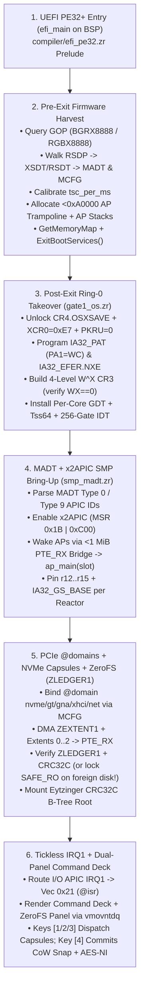

# `ZeroOS` — Bare-Metal Ring-0 Kernel & Reactor Architecture (`i7-1165G7`)

> [!IMPORTANT]
> **`ZeroOS`** (`examples/gate1_os.zr` + `examples/os/*.zr`) is a single-image, reactor-driven, strictly `W^X` Ring-0 monolithic operating system co-designed with the self-hosted **`Zero` (`.zr`)** compiler (`compiler/zero1.zr`, `--target=efi-os` and `--target=capsule`).
>
> Every hardware address, MSR, page-table flag, descriptor table, interrupt gate, PCIe `@domain` descriptor, multi-queue NVMe `@dma_queue` (`SQ1..SQ4` + `PRP-List`), and Scale-Out `ZeroFS` (`ZLEDGER1`) CoW storage path documented below is **implemented and verified today** in `build/gate1_os_z2.efi` (`192,000 B`) and `build/gate1_laptop_z2.efi` (`186,368 B`, `0` port-`0xE9` instructions), except Section 10 which explicitly blueprints the next hardware target (Gate 4: `Iris Xe` `8086:9a49` Gen12LP direct `ELSP` / EU compute).

---

## Table of Contents

1. [Verified Target Silicon & PCIe Topology (`Intel Core i7-1165G7`)](#1-verified-target-silicon--pcie-topology-intel-core-i7-1165g7)
2. [End-to-End Boot, SMP & Command Deck Lifecycle](#2-end-to-end-boot-smp--command-deck-lifecycle)
3. [`PE32+` Container & Physical Memory Layout](#3-pe32-container--physical-memory-layout)
4. [4-Level Hardware `W^X` Paging Engine & Dynamic Capsule Sealing](#4-4-level-hardware-wx-paging-engine--dynamic-capsule-sealing)
5. [The `ZeroOS` Reactor ABI, `gs:0` Faults & Zero-XSAVE Ring-0 `AVX-512`](#5-the-zeroos-reactor-abi-gs0-faults--zero-xsave-ring-0-avx-512)
6. [Cross-Core `MOVDIR64B` + Race-Free `MONITOR`/`MWAIT` Reactor Fabric](#6-cross-core-movdir64b--race-free-monitormwait-reactor-fabric)
7. [Tickless `I/O APIC` `IRQ1` Keyboard & `@isr` Verification](#7-tickless-io-apic-irq1-keyboard--isr-verification)
8. [PCIe `MCFG` + Lock-Free NVMe `@dma_queue` + `.zcap` Capsule Engine](#8-pcie-mcfg--lock-free-nvme-dma_queue--zcap-capsule-engine)
9. [Non-POSIX Hardware `@domain`s & `ZeroFS` (`ZLEDGER1`) CoW NVMe Engine](#9-non-posix-hardware-domains--zerofs-zledger1-cow-nvme-engine)
10. [Next-Stage Kernel Extension (Gate 4: `Iris Xe` `CCS0` GPU Compute)](#10-next-stage-kernel-extension-gate-4-iris-xe-ccs0-gpu-compute)

---

## 1. Verified Target Silicon & PCIe Topology (`Intel Core i7-1165G7`)

Every architectural decision in `ZeroOS` is anchored to direct inspection of `/proc/cpuinfo`, `lspci -nn`, and `/proc/bus/input/devices` on the reference Tiger Lake UP3 machine:

| Subsystem | Hardware Identity (`lspci -nn` / `CPUID`) | Present / Absent Features | Role & Programming Model in `ZeroOS` |
| :--- | :--- | :--- | :--- |
| **CPU Cores** | `11th Gen Intel Core i7-1165G7` (`Willow Cove`, `4C / 8T`) | `48 KiB` L1D, `1.25 MiB` L2, `12 MiB` L3; `39-bit` physical / `48-bit` virtual | **1 pinned permanent reactor per hardware thread** (`r12 = 0..N-1`); zero preemptive context-switch scheduler, zero thread migration. |
| **Vector & Crypto** | `AVX-512` (`F/BW/CD/DQ/VL/VBMI/VBMI2/VNNI/BITALG/VPOPCNTDQ/IFMA`), `AES-NI`, `VAES`, `SHA-NI`, `GFNI`, `BMI1/2`, `CRC32C` | **`XCR0 = 0xE7`** (`x87 + SSE + AVX + opmask + ZMM_Hi256 + Hi16_ZMM`) unlocked on BSP + all APs | `512-bit` `ZMM0..7` (`u32x16`, `u64x8`, `{k1}` opmask tails, `vmovntdq` GOP scanout) executed directly in Ring 0 under the **Zero-XSAVE `<tile>` law**; SSE4.2 `@crc32c` verifies NVMe superblocks and capsules. |
| **Cacheline Doorbells & Sleep** | `MOVDIR64B`, `MOVDIRI`, Ring-0 `MONITOR`/`MWAIT` | **`waitpkg` (`umwait`/`tpause`) Absent**; **`lam` Absent** | `publish(addr, cell64)` emits `MOVDIR64B` (`66 0F 38 F8`); `wait(...)` emits Intel SDM §9.10.4 race-free Ring-0 `MONITOR` + recheck + `MWAIT` + `IA32_TSC_DEADLINE` (`MSR 0x6E0`), with `CPUID.01H:ECX[3]` fallback to `PAUSE`/`sti; hlt` on hypervisors without `MWAIT`. |
| **Memory Protection** | `4-level PML4` (`pdpe1gb`, `NX`), `PKU` (`OSPKE`) | `5-level la57` Absent | Full `W^X` `CR3` hierarchy (`verify_no_wx_pages() == 0`) + `PKRU = 0` initialized across all cores. |
| **APIC & Timers** | Register-mode `x2APIC` (`MSR 0x800..0x83F`), `I/O APIC` (`0xFEC0_0000`), invariant `TSC` | `x2apic`, `tsc_deadline_timer`, `constant_tsc`, `nonstop_tsc` Present | `MADT`-driven `INIT-SIPI` SMP wake via `X2APIC_ICR_MSR` (`0x830`); `I/O APIC` routes `IRQ 1` $\rightarrow$ vector `0x21` with **zero periodic timer ticks**. |
| **Integrated GPU** | `00:02.0` Intel TigerLake-LP GT2 `[Iris Xe Graphics]` `[8086:9a49]` (`BAR0 = 0x60_0000_0000` `16 MiB` `GTTMMADR`, `BAR2 = 0x40_0000_0000` `256 MiB` `GMADR`) | `96` EUs (`768` hw threads), shared DRAM via `GGTT`/`PPGTT` + slice-local `SLM` + `WC` GOP; **supports direct hardware `ELSP` Execlists (zero GuC firmware required!)** | `@domain dom_gt : gt` discovered via `MCFG`; UEFI GOP mapped `PTE_WC_NX` (`PAT1 = WC`) and painted at 64 bytes/store via `AVX-512` `vmovntdq`. *(Direct Gen12LP EU compute = Gate 4).* |
| **Scoring Accelerator** | `00:08.0` Intel GNA Scoring Accelerator 2.0 `[8086:9a11]` (`BAR0 = 0x60_0113_d000` `4 KiB`) | Low-power neural/GMM DMA block *(No Meteor Lake NPU on this die)* | `@domain dom_gna : gna` bound via `MCFG` (`@domain ... : npu` is statically rejected at compile time on Tiger Lake). |
| **NVMe Storage** | `02:00.0` SK hynix BC511 NVMe SSD `[1c5c:1339]` | **Intel VMD Disabled** — directly visible via ACPI `MCFG`/`ECAM` (`Class 01h:08h:02h`) | `@domain dom_nvme : nvme` + Admin (`ASQ`/`ACQ`) + up to **`4` lockless per-reactor I/O `@dma_queue` pairs (`SQ1..SQ4` / `CQ1..CQ4`)** + `4 KiB` `PRP-List` scatter-gather DMA. |
| **Input & Buses** | `i8042` (`0x60`/`0x64` `@port`, `IRQ 1`), `00:14.0` xHCI `[8086:a0ed]`, `00:15.0/1` LPSS I2C `[8086:a0e8/9]`, `01:00.0` Wi-Fi 7 `[8086:272b]` | Built-in PS/2 AT keyboard + `ELAN0712` I2C touchpad + USB 3.2 boot | Interrupt-driven `IRQ1` scancode ring (`kbd_ring`) + GPT/FAT32 USB boot (`make usb-img`). |

---

## 2. End-to-End Boot, SMP & Command Deck Lifecycle



---

## 3. `PE32+` Container & Physical Memory Layout

`compiler/efi_pe32.zr` emits a standalone UEFI application (`Machine = 0x8664`, `Subsystem = 0x0A` `EFI_APPLICATION`, zero external linker, zero `.dll` imports) with strict section permission separation:

| Region / Offset | Permission | Size / Alignment | Exact Contents & Role |
| :--- | :---: | :---: | :--- |
| **PE32+ Headers** (`File 0x000..0x1FF`) | `RO` | `512 B` | DOS stub + COFF + Optional Header (`ImageBase` relocatable) + 3 Section Headers (`.text`, `.reloc`, `.bss`). |
| **`.text` (`RVA 0x1000`)** | **`RX`** (`0x60000020`) | `4 KiB` aligned | UEFI boot prelude, `< 1 MiB` AP trampoline template, 256 default fault stubs, compiled `.zr` kernel functions, `@isr` handlers, and inline RIP-relative string/rodata literals. |
| **`.reloc`** | **`RO`** (`0x42000040`) | `4 KiB` aligned | Minimal empty base-relocation block satisfying OVMF/AMI UEFI loader relocation checks while keeping all `.zr` code 100% RIP-relative. |
| **`.bss` + `+0x00040`** | **`RW+NX`** | `64 B` (`BootHandoff`) | Magic `'ZEROHAND'` (`0x5A45_524F_4841_4E44`), GOP geometry, `rsdp`/`madt`/`mcfg`, `ap_trampoline`, `tsc_per_ms`, `code_base`/`code_bytes`. |
| **`.bss` + `+0x00100`** | **`RW+NX`** | `16 KiB` (`MemRange[]`) | Normalized memory ranges (`kind 1` WB DRAM, `kind 2` WC GOP, `kind 3` UC MMIO, `kind 5` RO ACPI). |
| **`.bss` + `+0x04000`** | **`RW+NX`** | `32 KiB` | Raw UEFI `GetMemoryMap` descriptor buffer harvested immediately prior to `ExitBootServices()`. |
| **`.bss` + `+0x1C000`** | **`RW+NX`** | `112 KiB` (`..0x1C000`) | 64-byte-aligned BSP Ring-0 execution stack (`stack_top` at `+0x1C000`), `+0x1C040` `isr_line` fault vector cell. |
| **`.bss` + `+0x1E000`** | **`RW+NX`** | `16 x 64 B = 1 KiB` | `ReactorLocal[0..15]` per-core state blocks pointed to by `r15` and `IA32_GS_BASE` (`MSR 0xC000_0101`). |
| **`.bss` + `+0x20000`** | **`RW+NX`** | Static topological layout | All kernel `@slab`, `@ring` (`64 B` aligned), and `@dma_queue` (`4 KiB` page-aligned) spaces (`gdt_slab`, `tss_slab`, `idt_slab`, `pt_pool`, `worker_inbox`, `nvme_admin_sq/cq`, `nvme_io_sq1/cq1`, etc.). |
| **`@capsule boot_capsule`** | **`RW+NX` $\rightarrow$ `RX` / `RO+NX`** | `256 KiB` (`4 x 64 KiB` slots, `4 KiB` aligned) | Mapped purely with **4 KiB PTEs** (never 2 MiB hugepages) so individual 64 KiB capsule slots flip cleanly from `PTE_RW_NX` (during NVMe DMA) to `PTE_RX` (`seal_capsule_wx_rx`) after `@crc32c` verification. |
| **`< 0xA0000` AP Bridge** | **`RX`** (`4 KiB`) | Allocated `< 640 KiB` pre-exit | Required because EDK2's `MpInitChangeApLoopCallback` broadcasts `INIT` to APs during `ExitBootServices()`, forcing APs through 16-bit Real Mode `SIPI` vector `VV00:0000` before jumping straight into 64-bit `.zr` `fn ap_main(slot)`. |

---

## 4. 4-Level Hardware `W^X` Paging Engine & Dynamic Capsule Sealing

`examples/os/paging_wx.zr` constructs an identity-mapped 4-level `CR3` hierarchy inside `pt_pool` (`512` 4 KiB page-table frames = `2 MiB` pool) using `Zero` hardware bit-slice indexing (`addr[47:39]`, `addr[38:30]`, `addr[29:21]`, `addr[20:12]`) and programmable `@PtePtr` (`@ptr<u64 | mask: 0x000F_FFFF_FFFF_F000>`) pointers:

```text
 63  62       52 51                                   12 11  9 8   7   6   5   4    3   2   1   0
┌───┬───────────┬───────────────────────────────────────┬─────┬──┬───┬───┬───┬────┬───┬───┬───┬───┐
│NX │  Ignored  │       4 KiB Physical Frame Addr       │ AVL │G │PS │ D │ A │PCD │PWT│U/S│R/W│ P │
└───┴───────────┴───────────────────────────────────────┴─────┴──┴───┴───┴───┴────┴───┴───┴───┴───┘
```

| Mapping Class | `ZeroOS` Constant | Exact Hex Mask | Hardware Caching & Access Semantics |
| :--- | :--- | :--- | :--- |
| **Directory Link (`PML4E`/`PDPTE`/`PDE`)** | `PTE_DIR` | `0x0000_0000_0000_0003` | `P=1, RW=1, NX=0` (leaf permissions refine access at lower levels). |
| **Kernel `.text`, `<1M` Bridge, Sealed `@capsule`** | `PTE_RX` | `0x0000_0000_0000_0001` | `WB` Write-Back (`PAT0`), **Read + Execute (`RW=0, NX=0`)**. |
| **Usable DRAM (`.bss`, Stacks, `@slab`, `@ring`)** | `PTE_RW_NX` | `0x8000_0000_0000_0003` | `WB` Write-Back (`PAT0`), **Read + Write, Never-Execute (`RW=1, NX=1`)**. |
| **ACPI Tables (`RSDP`, `XSDT`, `MADT`, `MCFG`) & Unused Capsule Slots** | `PTE_RO_NX` | `0x8000_0000_0000_0001` | `WB` Write-Back (`PAT0`), **Read-Only, Never-Execute (`RW=0, NX=1`)**. |
| **UEFI GOP Scanout Framebuffer** | `PTE_WC_NX` | `0x8000_0000_0000_000B` | `WC` Write-Combining (`PWT=1, PCD=0` $\rightarrow$ `IA32_PAT.PA1 = 0x01`), **RW+NX**. |
| **PCIe `ECAM`, NVMe `BAR0`, `I/O APIC`** | `PTE_UC_NX` | `0x8000_0000_0000_001B` | `UC-` Uncacheable (`PWT=1, PCD=1`), **RW+NX** (strong MMIO ordering). |

### Two Critical `W^X` Invariants

1. **Zero Hugepage Overlap on Executable/Sealable Spans:**
   `build_wx_pagetables` uses `1 GiB` and `2 MiB` (`PDE_PS`) hugepages aggressively for bulk DRAM, *except* any `1 GiB` / `2 MiB` window overlapping `.text`, `ap_trampoline`, `gop`, or `boot_capsule` automatically drops down to **4 KiB PTEs**. Consequently, `seal_capsule_wx_rx` flips 64 KiB capsule slots from `PTE_RW_NX` to `PTE_RX` (+ `@invlpg`) in $O(1)$ without splitting live hugepages.
2. **Exhaustive 4-Level Hardware Audit (`verify_no_wx_pages`):**
   Both immediately after loading `CR3` and immediately after sealing NVMe capsules, `verify_no_wx_pages()` walks every present `PML4E -> PDPTE -> PDE -> PTE` via `@PtePtr` and halts the CPU if *any* leaf has `RW == 1 && NX == 0` (`WX=0` verified on every boot).

---

## 5. The `ZeroOS` Reactor ABI, `gs:0` Faults & Zero-XSAVE Ring-0 `AVX-512`

### 5.1 Register Calling & Pinning Convention (`--target=efi-os` and `--target=capsule`)

Unlike the System V ABI (which uses `rcx` as argument 4, colliding with variable shift counts `cl`), the `ZeroOS` Reactor ABI frees `rcx` for shifts/loops and permanently dedicates `r12..r15` to zero-lookup reactor state:

| Register(s) | ABI Role in `--target=efi-os` & `--target=capsule` | Hardware / Intrinsic Binding |
| :--- | :--- | :--- |
| **`rdi, rsi, rdx, r10, r8, r9`** | Arguments `0..5` (`arg3 = r10` instead of `rcx`!) | Scalar / pointer args (`u32x16`/`u64x8` passed by 64B-aligned hidden address). |
| **`rax` (`rax:rdx` / `zmm0`)** | Return value | `64b` scalar in `rax`; `16B` slice `{base, len}` in `rax:rdx`; `512b` vector in `zmm0`. |
| **`rbx`** | Callee-saved general register | Preserved across calls. |
| **`r12`** *(Pinned)* | Immutable **Reactor ID** (`0` = BSP, `1..N-1` = AP workers) | Read in `1` `mov` via `@reactor_id()`. Never modified by compiler codegen. |
| **`r13`** *(Pinned)* | Reactor **Inbox Base** (`worker_inbox` slot pointer) | Read via `@inbox_base()`. |
| **`r14`** *(Pinned)* | Per-Reactor **Scratch Arena Base** | Read via `@scratch_base()`. |
| **`r15` + `IA32_GS_BASE`** *(Pinned)* | Per-Reactor **`ReactorLocal` Control Block** (`64 B`) | Read via `@local_base()`; compiler emits per-core fault/tile operations directly against `[gs:disp8]`! |

### 5.2 Exact `ReactorLocal` (`gs:0`) 64-Byte Cacheline Layout

```text
GS Offset   Field Name          Width   Compiler & Kernel Invariant
──────────────────────────────────────────────────────────────────────────────────────────
[gs:0x00]   fault               u64     Active scalar `fail` code (`0` = healthy; `fail 0` -> `1`).
                                        Checked after every non-leaf call for zero-table stack unwind!
[gs:0x08]   tile_depth          u64     Nesting depth of active `<tile>` cooperative compute blocks.
[gs:0x10]   if_before_tile      u64     Saved `RFLAGS.IF` bit captured on outermost (`0 -> 1`) `<tile>` entry.
[gs:0x18]   inbox_seq           u64     Last processed `TaskCell.seq` on this worker reactor.
[gs:0x20]   mwait_capable       u64     `1` if `CPUID.01H:ECX[3]` (`MONITOR/MWAIT`) is supported on this CPU.
[gs:0x28]   movdir64b_capable   u64     `1` if `CPUID.07H:ECX[28]` (`MOVDIR64B`) is supported on this CPU.
[gs:0x30]   wake_count          u64     Count of cross-core `MWAIT` wakeups serviced by this reactor.
[gs:0x38]   last_latency_tsc    u64     Measured cross-core `MOVDIR64B -> MWAIT` round-trip `TSC` cycles.
```

### 5.3 The Zero-XSAVE Ring-0 `AVX-512` Proof (`<tile>` + `@isr`)

Traditional kernels either forbid `AVX-512` in Ring 0 or suffer massive latency saving/restoring `2.5 KiB` of `ZMM0..31` + `k0..7` state (`XSAVE64`/`XRSTOR64`) on interrupts and context switches. `ZeroOS` achieves **full-speed Ring-0 `AVX-512` with zero `XSAVE` instructions** by enforcing two complementary compile-time theorems in `compiler/`:

1. **Theorem A — Cooperative `<tile>` Vector Quantum (`RSP & 63 == 0`):**
   - On `--target=efi-os` and `--target=capsule`, **every** `u32x16`/`u64x8` type, `@vec_*` intrinsic, or `<simd: 8|16>` loop **must execute lexically inside `tile { ... }` (`for ... <tile>`)** — violating this is a compile error (verified by negative probes).
   - Every function frame pads `sub rsp, frame_bytes` so **`RSP & 63 == 0`** holds inductively across calls (`8B return_rip + 8B push_rbp + 48B/112B/... locals == 64 * k`), guaranteeing aligned 64-byte `vmovdqa64`/`vmovdqu64` vector temporaries without dynamic `and rsp, -64`.
   - Exiting the outermost `<tile>` (`[gs:8]` transitions `1 -> 0` via normal exit, `return`, `break`, `continue`, or `recover`) automatically emits **`vzeroupper` (`C5 F8 77`)**, releasing upper vector state cleanly.
2. **Theorem B — Statically Verified GPR-Only Interrupt Service Routines (`@isr` / `@isr_ok`):**
   - Any function marked `@isr` emits hardware interrupt prolog/epilog (`push` of all volatile GPRs, `cld`, body, `pop` of all volatile GPRs, `iretq`) and may only call `@isr_ok` leaf helpers.
   - `compiler/` **rejects at compile time** any `ZMM`/`XMM`/FPU instruction, `<simd>`, `<tile>`, or non-`@isr_ok` call inside `@isr` or `@isr_ok`.
   - **Consequence:** An asynchronous hardware interrupt (such as `IRQ1` vector `0x21`) arriving mid-`<tile>` while `ZMM0..7` and `k1` hold live 512-bit data **cannot touch `ZMM0..31` or `k0..7`**, completing its entire ISR in `<40` GPR instructions and returning via `iretq` with `ZMM` registers 100% intact and **zero `XSAVE` overhead**!

---

## 6. Cross-Core `MOVDIR64B` + Race-Free `MONITOR`/`MWAIT` Reactor Fabric

Worker reactors (`r12 = 1..N-1`) never poll shared spinlocks. Instead, `examples/os/reactor_fabric.zr` connects cores via 64-byte cacheline-atomic `@cell64` rings:

```text
BSP (Reactor 0)                                     Worker Reactor k (1..N-1)
───────────────                                     ─────────────────────────
1. Build 64B `TaskCell` (`seq`, `cmd`, `seed0/1`)   Sleeping in C1/C1E power state after:
2. `publish(worker_inbox.slot_addr(k), task)`         `monitor(rax = slot_addr, ecx=0, edx=0)`
      │                                               recheck `[slot_addr] == old_seq`
      ▼                                               `mwait(eax=0, ecx=0)`
   `MOVDIR64B` writes all 64 bytes atomically   ───► Hardware monitor armed on slot cacheline
   directly to coherent memory (no sender RFO)        wakes Worker k in ~1,400–1,700 TSC cycles!
                                                    3. Executes `@call(capsule_entry, 40, 2)`
                                                       inside `tile { ... }` (`ZMM` unlocked)
4. Collects `ResultCell` from `bsp_completions` ◄─── 4. `publish(bsp_completions.slot_addr(k), res)`
```

- **Intel SDM §9.10.4 Race-Free `wait(addr, deadline_tsc, expected_old)` Lowering:**
  `compiler/loops_match.zr` lowers `wait` to:
  1. Program `IA32_TSC_DEADLINE` (`MSR 0x6E0`) if `deadline_tsc != 0`.
  2. Execute `monitor` (`0F 01 C8`) on `addr` (`rax`) **first** to arm the core's address-range hardware monitor.
  3. **Re-read `[addr]` and compare against `expected_old` *after* `monitor` is armed** — if a `MOVDIR64B` store arrived just before `monitor`, the recheck catches it immediately and skips `mwait` (preventing lost-wakeup hangs!).
  4. Execute `mwait` (`0F 01 C9`).

---

## 7. Tickless `I/O APIC` `IRQ1` Keyboard & `@isr` Verification

`examples/os/ioapic_kbd.zr` drives the interactive Obsidian Command Deck with **zero periodic timer interrupts**:

1. **Legacy 8259 PIC Masking:** Writes `0xFF` to `@port pic1_data` (`0x21`) and `@port pic2_data` (`0xA1`).
2. **ACPI `MADT` `I/O APIC` & `ISO` Discovery:** Walks `MADT` Entry Type `1` (`I/O APIC` physical base, default `0xFEC0_0000`) and Entry Type `2` (Interrupt Source Override remapping ISA `IRQ 1` $\rightarrow$ Global System Interrupt `kbd_gsi`, honoring polarity/trigger flags).
3. **`UC+NX` Redirection Programming:** Maps `ioapic_phys` as `PTE_UC_NX` and programs the 64-bit redirection entry for `kbd_gsi` to fixed vector `0x21` targeting the BSP APIC ID.
4. **GPR-Only `@isr fn kbd_irq1_isr()`:** Reads `@port kbd_status` (`0x64`) & `@port kbd_data` (`0x60`), writes the scancode into `kbd_ring[w & 63]`, increments the 64-byte-aligned `kbd_state[0]` (`write_seq`, waking the BSP's `MWAIT` monitor!), increments `kbd_state[5]` (`irq1_count`), and acknowledges Local `x2APIC` `EOI` (`MSR 0x80B = 0`).

---

## 8. PCIe `MCFG` + Multi-Queue NVMe (`SQ1..SQ4`, `PRP-List`) + `.zcap` Capsule Engine

`examples/os/nvme_capsule.zr` brings up multi-queue bare-metal NVMe scatter-gather DMA, hardware-verified `.zcap` capsules, and Scale-Out `ZeroFS` (`ZLEDGER1`) in pure `.zr`:

1. **PCIe `MCFG`/`ECAM` Enumeration:** Reads `AcpiMcfgEntry` from `handoff.mcfg`, maps bus ECAM space `PTE_UC_NX`, locates PCI Class `01h` / Subclass `08h` / ProgIF `02h` (`NVMe`), enables `Command.MSE | Command.BME`, reads 64-bit `BAR0`, and maps `BAR0` (`0x2000 B`) `PTE_UC_NX`.
2. **Controller Reset, `MDTS`, & Per-Reactor Lockless `@dma_queue` Allocation (`SQ1..SQ4` / `CQ1..CQ4`):**
   - Clears `CC.EN`, awaits `CSTS.RDY == 0`, binds 4 KiB page-aligned `@dma_queue nvme_admin_sq` (`16 x 64B NvmeCmd`) and `nvme_admin_cq` (`16 x 16B NvmeCqe`) to `AQA`/`ASQ`/`ACQ`, sets `CC = 0x0046_0001` (`IOSQES=6, IOCQES=4, EN=1`), and awaits `CSTS.RDY == 1`.
   - Issues `Identify Controller` (`Opcode 0x06, CNS=1`) to extract hardware `MDTS` (`max_pages_per_cmd`, capped at `64` pages = `256 KiB`/cmd) and `Identify Namespace 1` (`CNS=0`) to extract exact `NSZE` & `LBADS` (`512 B` or `4096 B`).
   - Requests `want_qs = min(handoff.core_count, 4)` I/O queue pairs via `Set Features (FID = 0x07)` and creates `IOCQ1..k` (`Opcode 0x05`) + `IOSQ1..k` (`Opcode 0x01`) backed by `@dma_queue nvme_io_sq1..4` / `nvme_io_cq1..4` with `64 B` cacheline-isolated `NvmeQueueSeq[4]` sequence counters (`0` cross-core lock or cacheline bouncing!).
   - **Scatter-Gather `PRP` Builder (`nvme_io_submit_chunk_q`):** Transfers `1` page via `PRP1`, `2` pages via `PRP1 + PRP2`, and `3..64` pages in a **single NVMe command** by populating queue `q`'s dedicated `4 KiB`-aligned `@slab nvme_prp_lists` slot (`PRP2 = prp_list_phys`).
3. **Master Extent Table (`ZEXTENT1`) & `.zcap` (`ZEROZCAP`) Verification + `W^X` Sealing:**

```text
LBA 0: MasterExtentSuper (24 B) + MasterExtentEntry[0..3] (32 B each)
┌──────────────────────┬───────────┬──────────────┬────────────┐
│ magic = "ZEXTENT1"   │ version=1 │ extent_count │ generation │  + hardware @crc32c
└──────────────────────┴───────────┴──────────────┴────────────┘
         │
         ▼  Multi-Queue NVMe Read (Opcode 0x02) straight into 64 KiB slot k of `boot_capsule` (PTE_RW_NX)
┌───────────────────────────────────────────────────────────────────────────────────────┐
│ ZeroCapsuleHeader (64 B): magic="ZEROZCAP" | ver=1 | entry_off=64 | code_bytes | crc  │
├───────────────────────────────────────────────────────────────────────────────────────┤
│ Pure Position-Independent Reactor-ABI x86-64 Code (+64 .. +64+code_bytes)             │
│ • Zero mutable .bss (rejected by --target=capsule)                                    │
│ • Uses r10 (arg3), r12 (@reactor_id), gs:0 faults, and <tile> AVX-512                 │
└───────────────────────────────────────────────────────────────────────────────────────┘
         │
         ▼  1. Verify outer extent @crc32c AND inner ZeroCapsuleHeader @crc32c (@halt on mismatch)
            2. seal_capsule_wx_rx(slot_base, 65536) -> flips 16 x 4K PTEs to PTE_RX + @invlpg
            3. verify_no_wx_pages() == 0 -> Ready for worker @call(entry_fn, 40, 2)!
```

---

## 9. Non-POSIX Hardware `@domain`s & Scale-Out `ZeroFS` (`ZLEDGER1`) CoW NVMe Engine

1. **Compile-Time Separated Hardware `@domain` Descriptors (`examples/os/hw_domains.zr`):**
   - `ZeroOS` abolishes `/dev/*` VFS device files: `@domain dom_nvme : nvme`, `dom_gt : gt`, `dom_gna : gna`, `dom_xhci : xhci`, and `dom_net : net` allocate `64 B`-aligned hardware descriptors bound directly via `MCFG`/`ECAM` (`discover_pci_domains`), rendered live in the right-hand `ZEROFS ZLEDGER1 // PCI DOMAINS` HUD panel (`DOM: NVME:4Q GT:ON ...`).
   - Naming `@domain ... : npu` on Tiger Lake (`i7-1165G7`) or indexing `@domain` as DRAM (`dom[0]`) is a **hard compile-time error**.
2. **Scale-Out `ZeroFS` (`ZLEDGER1`) CoW Storage & Hardware Write Guard (`examples/os/zerofs_ledger.zr` + `examples/os/nvme_capsule.zr`):**
   - **Unified Disk Layout:** `Bucket 0` (`0..2 MiB`) holds immutable `ZEXTENT1` boot capsules; `Buckets 1..2` (`0x20_0000` / `0x40_0000`) hold alternating `ZLedgerSuperblock @cell64` mirrors; `Buckets 3..M` (`>= 0x60_0000`) hold `2 MiB` append-only generational CoW buckets (`level = 0` `LedgerKey` leaves + `level = 1..2` `EytzPivot` Merkle-`CRC32C` branches, `4 KiB` `ZfsGenHdr` `ZGENTBL1` generation pages, `+0x1FF000` `ZfsBucketFooterHdr` `ZBPFOOT1` `Backpointer32[126]` footers, `000`/`010`/`100`/`111` extents, and `AES-128-CTR` + `SHA-NI` locked cachelines).
   - **Double Hardware NVMe Write Interlock:** `nvme_dma_write_pages_guarded_q` (`Opcode 0x01`) and `nvme_dma_flush_guarded_q` (`Opcode 0x00`) refuse all submissions unless `zfs_is_write_armed() == 1` (proven by reading a valid `ZLEDGER1` magic + `@crc32c` superblock off target media) **and** `byte_off >= 0x20_0000`. Foreign `GPT`/`LUKS`/`ext4` drives stay strictly in `SAFE_RO` (`0` sectors written, verified by SHA-256 disk hashing), and `Bucket 0` remains bit-for-bit untouched across CoW epochs.
   - **Cold-Reboot Scale-Out Mount (`mount_nvme_zerofs`):** Selects the highest valid `ZLEDGER1` superblock mirror (`A` vs `B`), restores `ZfsGenHdr` (`u16` bucket generations), unpacks single-page (`level == 0`) or multi-level (`level == 1`) Merkle-`CRC32C` Eytzinger B+Trees across `SQ1..SQ4`, and restores `+0x1FF000` `ZfsBucketFooterHdr` backpointer tables on all active CoW buckets.
   - **Ordered Multi-Queue `PRP-List` CoW Commit (`Key [4]` -> `exec_nvme_zerofs_cow_tx`):** Advances descending snapshot (`current_snap -= 1`), appends a `36`-key sharded batch (`35` open records + `1` `AES-128-CTR`/`SHA-NI` locked extent) in **one `16 KiB` (`4`-page) `PRP1 + PRP-List` NVMe command**, writes `ZfsGenHdr`, materializes either a `level = 0` root (`<= 63` keys, e.g. Boot 1 `0 -> 36` keys) or splits automatically into a **`level = 1` Merkle-`CRC32C` Eytzinger B+Tree** (`> 63` keys, e.g. Boot 2 `36 -> 72` keys across `2` leaves!), seals dirty `+0x1FF000` `ZBPFOOT1` footers, flushes all active queues, writes the alternating `ZLedgerSuperblock` mirror, flushes, and verifies multi-level NVMe Root$\rightarrow$Leaf descent + `4`-page `PRP-List` readback + `ptr* @oneshot` decrypt!

---

## 10. Next-Stage Kernel Extension (Gate 4: `Iris Xe` `8086:9a49` Gen12LP Direct EU Compute)

> [!NOTE]
> **Status — Future Gate 4 Target (Not Yet Lowered; Preserves Honesty Rule):**
> With `ZeroFS` (`ZLEDGER1`) scale-out complete, the next architectural gate speaks directly to the **Intel TigerLake-LP GT2 (`Iris Xe`, `8086:9a49`)** Execution Units from Ring 0 without Mesa, OpenCL, DRM/i915, or closed-source GuC firmware:
> - **Host Hardware Apertures Verified (`lspci -s 00:02.0 -nnv`):** `BAR0` (`GTTMMADR`) at `0x60_0000_0000` (`16 MiB` UC: `[0..8 MiB)` GT MMIO registers + `[8..16 MiB)` `8 MiB` `GGTT` Global GTT mapping `4 GiB` of GPU VA) and `BAR2` (`GMADR`) at `0x40_0000_0000` (`256 MiB` WC).
> - **Why Tiger Lake `Gen12LP` Is Uniquely Direct-to-Metal:** Unlike Meteor Lake / Lunar Lake (which mandate encrypted GuC firmware microcontrollers for command submission), **Tiger Lake `Gen12LP` (`GFX_VER = 12.0`) natively supports direct CPU Ring-0 Hardware Execlist Submission (`ELSP` at engine base `+0x2230`, `RCS0 = 0x02000` / `CCS0 = 0x1A000`)**!
> - **Planned Gate-4 Sequence:** `FORCEWAKE_RENDER` (`0xA278`) / `FORCEWAKE_GT` (`0xA188`) wake handshake (`FORCEWAKE_ACK`), `GGTT` / 48-bit `PPGTT` page binding over shared `WB` DRAM `@slab`s, native Gen12LP EU binary kernel emission (`96` EUs / `768` hardware threads), and direct `ELSP` ring submission + hardware `Context Status Buffer (CSB)` completion polling.
